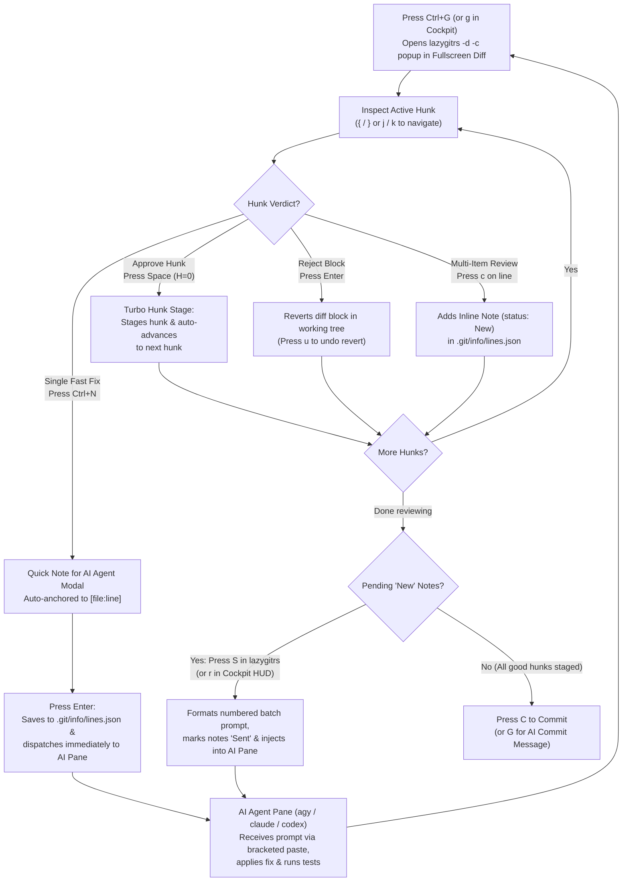

# State-of-the-Art Terminal Agent Workflow: Architecture, Ergonomics & Competitor Benchmark

> **Canonical Architectural Reference:** `docs/architecture/state-of-the-art-terminal-agent-workflow.md`  
> **Status:** Production Standard (re-audited 29 Oct 2026) · **Comparative Score:** **8.55 / 10** (profile-weighted, see §1; TUIOS 8.05; 7.7 on 18 Oct) · **Zero-Churn Verified**

> [!NOTE]
> This document was re-audited in Oct 2026. The previous revision claimed a self-assigned **9.94/10**, cited competitor latencies without a reproducible method, and referenced unverified benchmarks. Every number below is either **measured on this host** (aarch64 Linux, see §5) or explicitly marked as **unmeasured / reported by the vendor**. The 29 Oct re-audit re-read every competitor's repository (README, changelog, release notes), added TUIOS, agent-deck and Alethe to the scorecard, and lists the other new entrants in a radar (§2.2).

---

## 1. Executive Summary & Comparative Verdict

Modern agentic engineering demands orchestrating multiple concurrent AI coding subagents across isolated Git branches, monitoring asynchronous execution states, reviewing generated diffs, and pruning ephemeral environments without cognitive context switching.

This repository implements a terminal-native agent orchestration stack:

1. **`waymux`** ([felipecm-br/waymux](https://github.com/felipecm-br/waymux), v0.6.0): single Rust binary providing the async JSON-RPC 2.0 control plane (`agentState/wait`, `queue/*`, `agent/recap`, `tmux.*`), zero-latency lifecycle hooks (`waymux hook tmux|lazygit`), the Cockpit HUD data path (`cockpit-items|preview|diff`), delivery-safe prompt and review-note dispatch (`queue`, `review-notes`, `inject`), held approvals, turn checkpoints (`checkpoint`), triage (`triage`), a phone page for held prompts (`/m`, `phone-token`), and a native worktree orchestrator (`waymux wt`, mirrored by the `awt` entrypoint).
2. **`awt`** (Agent Worktree Orchestrator): worktree lifecycle management, hermetic environment provisioning, dirty-state migration (`-W`), quarantine-safe deletion, `rebase`/`ship`/`sweep`/`reap`.
3. **`waymaker` / `wm`**: SIMD-accelerated (Nucleo) Ratatui fuzzy selector used as the Cockpit renderer.
4. **`tmux`**: Golden Ratio ($\phi$) floating HUDs, event-driven status bars (`status-interval 0`), safe confirmation modals, and transaction-safe Undo Close Tab (`Prefix + u`).
5. **`lazygitrs`**: Rust Git TUI with Dual-Diff toggle (`Ctrl+G`), inline `.git/info/lines.json` review annotations, and batch agent review injection.
6. **Agent supply chain**: quota-aware launch and switching ([`ai-quota`, `ai-launch`, `ai-switch`, `ai-prompt`](quota-aware-agent-selection.md)), cross-session memory ([`ai-memory`](ai-memory-workflow.md)) and an opt-in sandbox for Claude ([`ai-jail`](../articles/ai-jail-memory-guide-en.md)); see §3.7.

```
                    ┌──────────────────────────────────────────────┐
                    │            TERMINAL WORKSPACE (Tmux)         │
                    │                                              │
    Prefix + Space  │   ┌──────────────────────────────────────┐   │
   ─────────────────┼──►│    COCKPIT HUD (waymux cockpit → wm) │   │
                    │   │  Fixed 6-Column Grid                 │   │
                    │   └──────────────────┬───────────────────┘   │
                    │                      │                       │
                    │         Select       │ Tab / Quick Action    │
                    │         Enter        │                       │
                    │         ▼            ▼                       │
                    │   ┌───────────────┐  ┌───────────────────┐   │
                    │   │  Active Pane  │  │ lazygitrs (Review)│   │
                    │   │  (Neovim/Zsh) │  │ Dual-Diff Ctrl+G  │   │
                    │   └───────▲───────┘  └─────────┬─────────┘   │
                    │           │ Batch Review Notes │ r / R / S   │
                    │           └────────────────────┘             │
                    └───────────────────────▲──────────────────────┘
                                            │
                       ┌────────────────────┴───────────────────┐
                       │  waymux daemon (127.0.0.1:4040)        │
                       │  hooks · agent state · urgency · wt    │
                       └────────────────────────────────────────┘
```

### Profile-Weighted Comparative Scorecard (29 Oct 2026)

Weights are calibrated for a **terminal-first, keyboard-only, Home-Row ($H=0$)** profile and are unchanged since 18 Oct, so composites compare across audits. Scores are the author's **subjective judgment** from each competitor's repository and docs, read on 29 Oct 2026 (versions in §2), plus local measurements. Where a capability could not be verified, it was scored conservatively. Bold marks the best score in each row.

| Dimension | Weight | This Stack | TUIOS | Orca | workmux | herdr | agent-deck | T3 Code | Alethe |
| :--- | :---: | :---: | :---: | :---: | :---: | :---: | :---: | :---: | :---: |
| Worktree lifecycle | 15 | 9.0 | 8.0 | 9.0 | **9.5** | 6.0 | 8.5 | 8.0 | 7.5 |
| Agent state awareness | 15 | 9.0 | **9.5** | 8.0 | 8.0 | **9.5** | 8.0 | 7.5 | 7.5 |
| Persistence / crash isolation | 10 | 8.0 | 9.0 | 7.0 | 7.0 | **9.5** | 7.5 | 6.5 | 6.0 |
| Review loop (diff → line note → agent) | 15 | **9.5** | 8.0 | 9.0 | 6.0 | 4.0 | 3.5 | 8.0 | 7.0 |
| Remote / mobile | 10 | 7.0 | 8.5 | **9.5** | 4.0 | 9.0 | 7.5 | **9.5** | 6.5 |
| Ergonomics & latency (keyboard, $H=0$) | 15 | **10.0** | 6.5 | 3.0 | 7.5 | 6.5 | 8.0 | 3.0 | 4.0 |
| Agent-callable API (`wait`, spawn, mail) | 5 | 9.0 | **10.0** | 7.5 | 6.0 | **10.0** | 8.0 | 6.5 | 8.5 |
| Agent sandboxing | 5 | 7.5 | 3.0 | 4.0 | **9.0** | 3.0 | 8.0 | 3.0 | 4.0 |
| Fan-out / compare N agents | 5 | 8.0 | **10.0** | **10.0** | 8.0 | 5.0 | 6.5 | 7.0 | 8.0 |
| Ecosystem / bus factor | 5 | 4.0 | 7.0 | **10.0** | 7.0 | **10.0** | 5.5 | 9.0 | 6.0 |
| **Composite (0–10)** | **100** | **8.55** | 8.05 | 7.58 | 7.25 | 7.15 | 7.10 | 6.85 | 6.48 |
| Composite on 18 Oct | | 7.7 | — | 7.2 | 7.1 | 6.9 | — | 6.6 | — |

**What moved since 18 Oct (+0.85 for this stack):**

- **State awareness 8.0 → 9.0:** triage by service class with the longest wait first, wait reasons, the `󰷋` done-not-reviewed state (a glance is not a review), the shared-repository badge, away recaps, alert bursts and the queued badge (§3.2, §3.3).
- **Persistence 7.5 → 8.0:** every agent turn is a restorable checkpoint kept outside the repository (`waymux checkpoint`), and `ai-memory` carries the workstream across sessions and harnesses.
- **Agent-callable API 8.5 → 9.0:** `queue/*` and `agent/recap` RPCs, and the `ai-memory` MCP tools.
- **Sandboxing 3.0 → 7.5:** Claude can run jailed (`Claude Jailed` row in `ai-launch`); git run by the daemon and the Cockpit no longer runs programs named by the repository's config (§2.3); and [`agent-sudo`](../tmux/agent-sudo-popup.md) lets a jailed agent ask for a privileged command through a narrow bridge (`agent-sudod`, one endpoint, no tmux access) that only a `y` in a popup on your client can approve. Jailed agents launched from `ai-launch` stay supervised through a hook token scoped to their own pane (`waymux` 0.5.0, §2.3). Capped at 7.5 because the jail is opt-in and an agent can still replace `.git` (§8 P1b).
- **Fan-out 4.0 → 8.0:** [`awt-fan`](../utils.md) starts one prompt in 1–8 worktrees across agents, gated by `ai-quota` (red refused, yellow capped at one attempt; neither TUIOS nor Orca checks quota before a fan), compares the attempts in a 40/60 Waymaker popup, asks a read-only Claude to judge, and keeps one (commit, merge into the base, remove every attempt after naming the ignored files it deletes). Short of TUIOS's 10: no checks or cost per attempt yet, and no Cockpit entry.
- **Remote 5.0 → 7.0:** a phone page (`waymux` 0.6.0, `/m` behind `tailscale serve`) lists every agent with held prompts first and answers them with Allow or Deny, confirming risky calls. Its token reaches two methods only, checked against the three TUIOS advisories of 26 Oct ([Recipe 4](remote-agent-workflow-waymux.md#recipe-4-answer-held-prompts-from-the-phone-m-waymux-06)). Short of TUIOS and Orca: no typing a new prompt, no diff view, no push notification.
- **Competitors:** TUIOS 0.11 (25–26 Oct) added a full-screen agent cockpit, threads for eight harnesses, fans of 1–8 attempts with compare and a read-only judge, and linked machines. Orca added diff-line annotations sent back to the agent, SSH worktrees and an Android app. herdr added machines over SSH and saves before the host shuts down. workmux added sidebar views and keeps finished agents marked until reviewed.

> [!IMPORTANT]
> **The lead holds on these weights (8.55 vs TUIOS 8.05), when the ergonomics weight is halved (8.42 vs 8.19), and when the remote weight is doubled (8.38 vs 8.10).** This stack leads on ergonomics and latency, the review loop, and quota-aware launch and fan-out. It trails on remote/mobile and ecosystem. The rest of the roadmap in §8 (pinning `.git` in the jail, checks and cost per fan attempt) brings it to 8.60 on the same weights.

### Emerging Capabilities (not weighted)

Capabilities that several competitors shipped since 18 Oct. They are kept out of the composite so the scores stay comparable across audits.

| Capability | This Stack | Best competitor implementation | Verdict |
| :--- | :--- | :--- | :--- |
| **Quota & cost-aware routing** | `ai-quota`: server-reported Claude 5h/7d, burn rate, projection at reset, weekly pace; Antigravity quota per model group; quota-ranked `ai-launch` menu; in-place `ai-switch` | Alethe: usage per provider, quota headroom in every orchestrator answer, routing rules gated on quota (critical at 80%), fallback roles, hard budgets for calls, wall time, tokens and cost | **Parity:** deeper telemetry here, automatic routing there |
| **Cross-session memory & handoff** | `ai-memory` hooks and MCP; `ai-memory run` workstreams across Claude, Codex, OpenCode and Antigravity; Undo Close Tab with resume | Alethe: resume after a crash for four CLIs, recent chats per folder, Claude ↔ Codex redacted context packet, managed `ai-memory` install | **Parity** (same `ai-memory` backend) |
| **Lead-agent orchestration** | None: agents are peers, chained by scripts with `agentState/wait` | Alethe Orchestration v2 board; agent-deck conductor escalating to Telegram or Slack; agtx orchestrator agent | **Gap**, acceptable for a single-human workflow |
| **Control-plane safety** | Delivery queue, live re-check and 400 ms dwell, risk rules, held approvals, `Esc` deny, kill guard, ship confirmation; hardened host-side git; `agent-sudo` approval popup | TUIOS: the same guards, plus four security fixes in Oct (git config, linked-machine file access, OSC 52 query, cross-pane approvals) | **Close behind:** P0 and P5 landed; TUIOS has had outside security review, this stack has not |

---

## 2. Competitor Matrix & Architecture Analysis

Sources, read on 29 Oct 2026: [TUIOS](https://github.com/Gaurav-Gosain/tuios) README and v0.11.0 / v0.11.1 release notes, [Orca](https://github.com/stablyai/orca) README, [workmux](https://github.com/raine/workmux) CHANGELOG, [herdr](https://github.com/ogulcancelik/herdr) v0.9.2–v0.9.5 release notes, [agent-deck](https://github.com/asheshgoplani/agent-deck) README, [T3 Code](https://github.com/pingdotgg/t3code) README and v0.1.4 notes, and [Alethe](https://github.com/Kc1t/alethe-agents) README, `docs/FEATURES.md`, `docs/CHANGELOG.md` and source (§2.1). Stars and versions are as of that day and change quickly.

| Capability | This Stack | TUIOS 0.11.1 | Orca 1.4.244 | workmux 0.1.277 | herdr 0.9.5 | agent-deck | T3 Code 0.1.4 | Alethe 1.7.0 + Unreleased |
| :--- | :--- | :--- | :--- | :--- | :--- | :--- | :--- | :--- |
| **Paradigm** | Rust daemon + CLIs + TUIs on tmux | Go multiplexer and window manager; daemon owns PTYs | Electron ADE + mobile companion | CLI glue: 1 worktree = 1 tmux window = 1 agent | Rust server owns PTYs; TUI and CLI are clients | Go TUI over tmux sessions | Server + web, desktop and mobile control surface | Tauri desktop app (Rust, React, `xterm.js`) |
| **Agent state** | Hooks, stall detection, multi-pane urgency, triage classes, `󰷋` | Hooks; Needs you / Ready for review / Working / Idle; threads for 8 harnesses | Notifications, unread threads | Hooks; sidebar; finished agents stay marked until reviewed | Screen analysis + integrations; agents can self-report | Polling; 4 states; waiting sessions in the tmux status bar | Thread status, subagents | Claude hooks + session-file watchers; worker cards |
| **Review loop** | `lazygitrs`: hunk stage + auto-advance, `Ctrl+N` note, batch `S` / `r`, delivered through the queue | `tuios review` line notes, diffs in threads, checkpoints tab | Annotate any diff line, send it to the agent | Dashboard diff and hunk staging | None built in | None (reviewer sessions) | Unified diffs, PR flow | Diff panes, worker diffs, read-only AI PR review |
| **Approvals** | Held `PermissionRequest`, 400 ms dwell, risk double-press | Same model (origin of ours) | Not verified | Focus the pane | Answer in the pane | Attach to the session | Not verified | Worker cards: once, session, decline, abort |
| **Fan-out** | `awt-fan`: 1–8 attempts across agents, quota-gated, compare popup, read-only judge, keep | 1–8 attempts, compare, read-only judge, keep | One prompt → N agents, compare, merge | Multi-worktree `add` | Manual | Fork, conductor workers | Parallel threads | Lead agent delegates to Claude / Codex workers |
| **Quota / cost** | `ai-quota` model, quota-ranked launch menu, in-place switch | Cost per fan attempt | Usage tracking, account switcher | None found | None found | Cost dashboard, context inspector | None found | Usage cards, quota-gated routing, hard budgets |
| **Sandboxing** | `ai-jail` for Claude (opt-in row) and opencode; `agent-sudo` bridge for approved root commands | None of its own | Not documented | Container / Lima backends | None | Docker per session | Worktree isolation | Codex workspace-write sandbox in Ask mode |
| **Crash model** | tmux owns PTYs; systemd-supervised daemon; turn checkpoints | Daemon owns PTYs; `restart-server` reattaches clients | Scrollback survives restarts | tmux owns PTYs | Server owns PTYs; saves before shutdown | tmux owns PTYs | Background service (`t3 service install`) | App owns PTYs; agents resume with `--resume` |
| **Remote / mobile** | SSH, mosh, Tailscale, phone page for held prompts (`/m`) | SSH hosts, tailnet, `tuios-web`, paired phone | iOS / Android, SSH worktrees | Terminal only | Saved machines over SSH | Web UI, remote decks, Telegram / Slack conductor | iOS / Android / web, several machines | LAN web view (plain HTTP), phone chat |
| **Keyboard model** | $H=0$, no `Alt`, modeless popups | Prefix; lock mode; tmux / zellij presets; `alt` drag | Mouse-first GUI | tmux prefix | Prefix (several allowed) | Single-key TUI | GUI | `Ctrl` chords, `Alt+←/→`, mouse board, voice |
| **License · ★** | MIT (`waymux`) · personal | MIT · 6.2k | MIT · 109k | MIT · 3.0k | Apache-2.0 · 46k | MIT · 1.2k | MIT · 31k | AGPL-3.0 · 1.1k |
| **Latency / memory** | **Measured** (§5) | Not measured | Not measured | Not measured | Not measured | Not measured | Not measured | Not measured |

### Deep Architectural Takeaways

1. **Runtime ownership:** herdr and TUIOS give a daemon the PTYs, with disposable clients and attach-from-anywhere; this stack reaches the same crash profile through tmux plus a supervised `waymux daemon`. Alethe is the outlier: its PTYs belong to the app process, so quitting or crashing it ends every agent, and sessions come back through each CLI's `--resume`. The earlier claim that herdr has a "catastrophic blast radius" was incorrect.
2. **Fixed-grid HUD vs. list dashboards:** the Cockpit's fixed 6-column monospace grid supports ballistic vertical scanning. workmux now offers `dashboard.layout: side_by_side` (the preview gets the full content height), converging on the 40/60 split. This is a design argument (saccade model), **not** a measured user-study result.
3. **The review loop alone is no longer the differentiator:** sending a per-line note back to the agent is now standard (Orca, Paradev, TUIOS, Conductor, and Vibe Kanban, which is shutting down). What remains distinctive is the cost and safety of the path: `Space` stages a hunk and advances, `Ctrl+N` anchors and sends a note in one action, notes go through the delivery queue so they never answer a prompt, and `󰷋` clears only after a real review.
4. **Orchestration moved into the products:** Alethe's lead agent delegates to workers through MCP with quota-gated roles and hard budgets, agent-deck's conductor escalates to a phone, and TUIOS fans out up to 8 attempts with a read-only judge. Agent vendors are absorbing the same layer (reported: GitHub Copilot multi-agent features at GitHub Universe, the Codex app folded into the ChatGPT desktop app). The durable advantage of this stack is the composition (tmux, Rust tools, $H=0$, measured budgets), not any single feature.
5. **Known gaps (honest):** no checks or cost per fan attempt (TUIOS shows both), a phone page that answers prompts but cannot start one or show a diff (TUIOS, Orca and T3 Code can), a jail that is opt-in with `.git` still writable (§8 P1b), and a single-maintainer core (`waymux` 0.6).

### 2.1 Alethe (`Kc1t/alethe-agents`) Deep Dive

[Alethe](https://github.com/Kc1t/alethe-agents) ("the multi-agent coding workspace": AGPL-3.0, created 15 Jun 2026, v1.7.0 on 20 Sep 2026, about 1.1k stars and 48 contributors) is a local-first Tauri desktop app (Rust backend, React and `xterm.js` frontend) for Windows, macOS and Linux. The facts below come from its README, `docs/FEATURES.md`, `docs/CHANGELOG.md` (the Unreleased section runs to 26 Oct) and its source.

| Area | What Alethe does (verified) | Compared with this stack |
| :--- | :--- | :--- |
| **Runtime** | Real PTYs through `portable-pty`, owned by the app. Closing a container hides it; shutting the app down kills every process tree (`kill_all_sessions_background`, 4 s timeout) | tmux owns the PTYs, so a UI crash costs nothing |
| **Agent state** | Claude Code `SubagentStart` / `SubagentStop` hooks on a token-guarded loopback listener, plus session-file watchers for Codex and others; sidebar rows stay lit while an agent thinks and show `✓` when an answer is ready | Richer here: stall detection, triage classes, wait reasons, `󰷋` |
| **Orchestration v2** | A lead Claude or Codex agent delegates through `alethe_delegate` (MCP). Workers report result, tokens, cost and diff on board cards; "waiting on you" outranks every other state; workers ask before leaving their sandbox (once, session, decline, abort); Claude and Codex native subagents join the same board; shells the lead starts become board nodes | No lead-agent layer: agents are peers, chained by scripts through `agentState/wait` |
| **Quota & cost** | Opt-in usage reading per provider (Claude, Codex, Antigravity, Kimi), quota headroom in every orchestrator answer, routing rules over task kind × effort × quota gates, fallback roles, hard budgets, cheap and strong tiers | `ai-quota` models burn rate, projection at reset and weekly pace, which Alethe does not; Alethe routes delegated work automatically, which this stack does not |
| **Continuity** | Resume after a crash or restart (Claude, Codex, Cursor, OpenCode), recent chats per folder, Claude ↔ Codex handoff through a redacted context packet, managed `ai-memory` install (hash-checked) wired into the agents it launches | Same `ai-memory` backend; `ai-memory run` covers the cross-harness handoff |
| **Shared config** | MCP tab: every MCP server on the machine, grouped by server with the agents that have it; copy between agents, registry search, reachability check, backed-up atomic writes. Skills tab | No equivalent: MCP config stays per harness (`claude`, `agy`, `codex`, `opencode`, `devin`) |
| **Review** | Git panel, diff panes, worker diffs, read-only AI PR review inside the worktree; squash merge blocked when the head SHA moved, the PR is a draft, or GitHub reports conflicts | Per-line notes, hunk staging and the delivery queue are ahead here |
| **Remote** | LAN web view paired by QR code: phone terminal, chat view, question cards, start agents. Plain HTTP/WebSocket on the LAN, off by default, fails closed | SSH / mosh over Tailscale: encrypted, but no phone UI |
| **Keyboard** | `Ctrl+T`, `Ctrl+P`, `Ctrl+1…9`, `Shift+Tab`, `Alt+←/→` history; drag-and-drop layouts; a mouse-driven board; voice commands (`Ctrl+E` dictation, hands-free send phrases) | The `Alt` chords and the mouse board conflict with the $H=0$ rule |
| **Sandbox** | "Agent Sandbox" is a workspace concept. Real confinement comes only from Codex's workspace-write sandbox in Ask mode; a read-only Claude worker is refused | `ai-jail` (bubblewrap + Landlock + seccomp) for Claude |
| **Extensibility** | Plugins declare capabilities in a manifest; the catalogue pins each package by SHA-256; installed plugins arrive disabled behind a trust dialog | Composition of standalone tools (stow packages) |

**Worth absorbing:** an MCP inventory across the installed harnesses (a `wm` picker over their MCP configs), a view of leftover dev-server processes that outlive their window (fits `close-window.sh` and `dev-gc`), and quota-gated fallback with hard budgets once fan-out exists (§8 P2). **Rejected:** the GUI board, `Alt` chords, unencrypted LAN remote and app-owned PTYs.

### 2.2 Competitor Radar (not scored)

New or changed entrants found on 29 Oct 2026 through GitHub search and vendor pages. They are not scored because they are macOS-only, GUI-first with no keyboard path for this profile, inactive, or already part of this stack.

| Tool | ★ · status (29 Oct) | Positioning | Why not scored |
| :--- | :--- | :--- | :--- |
| [Warp](https://github.com/warpdotdev/warp) | 65.7k · client now open source (AGPL-3.0, UI crates MIT), OpenAI as founding sponsor | Agentic development environment born from the terminal; runs third-party CLI agents; "Warp Factories" | Replaces the terminal and tmux; brings its own agent stack |
| [cmux](https://github.com/manaflow-ai/cmux) | 28.6k · active | Native macOS terminal (Swift, Ghostty-based): notification rings, sidebar with branch, PR and ports, SSH workspaces, `cmux claude-teams`, scriptable browser | macOS only |
| [Vibe Kanban](https://github.com/BloopAI/vibe-kanban) | 28.5k · **sunsetting** | Kanban issues → agent workspaces, inline diff comments sent to the agent, PRs | Shutting down |
| [Paradev](https://github.com/ParadevAI/Paradev) (formerly Superset) | 15.7k · active | Agentic IDE for many parallel agents: diff-line feedback, Design mode, PR review | macOS first; the Linux build is x86_64 only (this host is aarch64) |
| [OpenChamber](https://github.com/openchamber/openchamber) | 12.3k · active | OpenCode-based workspace: Multi-run (up to 5 models), guided change walkthroughs, desktop, web, VS Code and mobile | GUI, OpenCode-centric |
| [worktrunk](https://github.com/max-sixty/worktrunk) | 9.5k · active | Worktree CLI for parallel agents | Already a dependency of `awt` |
| [Claude Squad](https://github.com/smtg-ai/claude-squad) | 8.7k · last push 20 Aug | tmux + worktree session manager | Inactive for two months |
| [Emdash](https://github.com/generalaction/emdash) | 6.1k · active (YC W26) | Desktop app: agents in worktrees, issue trackers, SSH remotes, CI checks | GUI |
| [nodeterm](https://github.com/eneskirca/nodeterm) | 2.1k · active | Canvas of tmux-backed agent nodes plus a kanban view; answer prompts inside a node | Spatial canvas, mouse-first |
| [Xum](https://github.com/coder/xum) (formerly coder/mux) | 2.1k · active | Desktop app: worktree or SSH runtimes, code review, mobile web | GUI |
| [dmux](https://github.com/standardagents/dmux) | 1.8k · last push 16 Aug | tmux + worktree multiplexer | Inactive for two months |
| [agtx](https://github.com/fynnfluegge/agtx) | 1.7k · active | Kanban TUI with vim keys, phase-based multi-agent tasks, orchestrator agent over MCP, mobile web app | Spec-driven workflow; the TUI to watch after agent-deck |
| Conductor | closed source | Mac app: Claude Code and Codex in worktrees, checks tab, diff comments; Conductor Cloud | macOS (Apple Silicon) only |

### 2.3 Open Finding: Host-Side Git in Agent-Writable Repositories

TUIOS 0.11.1 fixed [GHSA-qcx6-vr32-xr8q](https://github.com/Gaurav-Gosain/tuios/security/advisories/GHSA-qcx6-vr32-xr8q): its daemon ran git (checkpoints, reviews, counts) with the repository's own config, so a program in the pane could make the daemon run a command outside the pane's sandbox. **The same class applies here**, verified on 29 Oct 2026 in a scratch repository:

- `waymux` runs git in agent repositories from the daemon and the Cockpit: turn checkpoints (which include the repository's config on purpose, for filters) and the Cockpit diffstat. Both ran a command named in repository-local git config; `--no-ext-diff` alone does not prevent it.
- `ai-jail` mounts the project read-write, so a jailed agent can change that config, and in a linked worktree the `.git` pointer file itself sits inside the writable mount. Any host-side git command in that directory, the daemon's included, then runs outside the jail.
- **`agent-sudo`** (privileged commands for jailed agents, approved in a popup) runs the approved command as root **outside the jail, in the agent's own directory**. The popup flags interpreters, build tools and executables inside that directory, and ignores keys for 400 ms after it opens; the remaining risk is approving a flagged command.
- Jailed agents also lose supervision: the jail unshares the network and relays only the ai-memory port (49374), so `waymux hook` cannot reach the daemon, and the pane gets no hook state, held approvals, checkpoints or `󰷋`. P1 fixes this with a pane-scoped hook token (below).

**Status:** §8 P0 landed in `waymux` on 29 Oct (`src/git.rs`; released in `waymux` v0.4.0 the same day): git run by the daemon and the Cockpit no longer runs fsmonitor, hooks, or filter and diff drivers from local config (about +4 ms on the Cockpit data path). The `agent-sudo` popup now ignores keys for 400 ms and flags build tools and executables inside the request's directory (P5).

**`lazygitrs` audit (29 Oct):** it runs the git CLI for everything, reads and your own actions alike, so it cannot simply drop the repository's config the way the daemon does: staging in a git-crypt repository needs the filter git-crypt writes into local config. What needs no action from you is `core.fsmonitor`, which every `status` runs, including the shell prompt's. It is now off for every git on this host: config from the environment outranks the repository's (`GIT_CONFIG_*` in `zsh/.zshenv`, and `set-environment -g` in `tmux.conf` for popups). Filter and diff drivers and hooks still run when an agent can write the repository's config, so they belong to the jail: `ai-jail --map <git-dir>/config --map <git-dir>/hooks` keeps both read-only while the agent can still commit (verified), but the agent can still rename `.git` away and create its own, which the host then follows. Pinning `.git` needs an ai-jail change (§8 P1b).

**P1 (released in `waymux` 0.5.0, 29 Oct):** `waymux hook-token <pane>` mints a token that reaches only `/api/status` and `approval/hold` for that pane, checked before the call runs (403 otherwise). `ai-launch jail-claude` mints one when it starts in tmux and passes it with `--env` (never argv), forwards the daemon port and maps `waymux` read-only. Verified inside `ai-jail` against a private daemon: the daemon token stays hidden, the jailed hook updates its own pane, and another pane's status, `tmux.send_keys`, `queue/push` and `hook/token` get 403. With an older daemon, the jail starts unsupervised as before.

Still open: P1b. Until it lands, treat the `Claude Jailed` row as accident prevention, which is how ai-jail describes itself, not as a boundary against a prompt-injected agent.

---

## 3. The 7 Engineered SOTA Pillars

### 3.1 Worktree Provisioning & Isolation (`awt`)

The Agent Worktree Orchestrator (`awt`, bash entrypoint; also exposed as the native `waymux wt`) treats Git worktrees as disposable, hermetic sandboxes for autonomous agents.

- **Single-Pass Queries:** Avoids multiple sequential `git status` or `git branch` invocations. Resolves branch names, upstream status, commit divergence, and dirty state in a single query.
- **Dirty-State Migration (`awt -c -W <branch>`):** Automatically snapshots uncommitted changes in the current tree and applies them cleanly into the newly created worktree without leaving untracked residue behind.
- **Instant Async Trash Deletion:** `awt-delete.sh` atomically renames removed worktree directories to `.awt_trash_<name>_$$_$RANDOM` and purges them asynchronously in a background subshell (`rm -rf "$trash_dir" &`), returning control to the UI immediately while pruning metadata cleanly.
- **Hermetic Environment Hooks (`.awt.toml` & `post-create.sh`):** Automatically copies or symlinks `.env`, `.env.local`, and runtime secrets into newly created worktrees while honoring worktree isolation boundaries.
- **Worktree Permission Policy:** `post-create.sh` gives each new worktree a Claude Code `acceptEdits` policy that still asks before `git push`, `gh pr create` and `gh pr merge`, so edit prompts disappear where lazygitrs reviews the diff anyway, while outward actions stay gated. This is a permission policy, not a sandbox: commands still run with full user rights. See [Lifecycle Hooks](../GIT_WORKTREE_AGENTIC_WORKFLOW.md#i-worktree-lifecycle-hooks-architecture-post-create-pre-merge-post-merge-pre-remove).
- **Linear History & Fleet Hygiene (`awt rebase`, `awt sweep`, `awt reap`):** Integrated linear rebase, merged-worktree sweeping (`awt sweep`), and stale idle-agent garbage collection (`awt reap --hours 4`).

### 3.2 Instant Cockpit HUD (`cockpit-picker` + `waymaker`)

The Cockpit HUD is the central control plane, bound to `Prefix + Space` (`85% × 75%`, badge ` 󱂬 `).

```
┌────────────────────────────────────────────────────────────────────────────────────────┐
│ 󱂬  Fleet (All Windows) ❯                                        ? Help · Esc Close     │
├────────────────────────────────────────────────────────────────────────────────────────┤
│ 󰳌  1•  dotfiles · agy: Audit docs   main ↑2         +14 -3      2m                     │
│ 󰑮  2   api · claude: Fix auth       feat/auth ✓     +42 -8  #12 35s                   │
│ 󰔟  3   web · codex: Add tests       fix/tests ↑1    +5 -1       4m                     │
│ ·  4   nvim                         main ✓          clean       12m                    │
├────────────────────────────────────────────────────────────────────────────────────────┤
│ Enter Jump │ y/n Ack │ r Notes │ i Input │ g Git │ a Agents │ ? Help                   │
└────────────────────────────────────────────────────────────────────────────────────────┘
```

- **Sub-50ms Data-Path Latency (`waymux cockpit-items` $P_{50} \approx 19\text{ms}$ measured; see §5):** Streams pre-formatted candidate lines into `wm --config cockpit-picker.toml` with zero intermediate disk scans.
- **Fixed 6-Column Golden Grid (`cockpit-picker-items.sh`):** Monospace columns provide dedicated vertical tracks in the left 40% candidate pane:
  1. `[State Icon]` (2 chars anchored at $X=1$: `󰳌` permission, `󱜻` question, spinner working, `󰔟` stalled, `` error, `󰗡` idle, `·` no agent). Rows sort by the triage service class (permission → question → error/stalled → working → idle), waiting rows oldest first, and the cursor opens on the first waiting agent.
  2. `[Win Idx + Dot]` (3 chars: e.g. `1•` for active window, `2 ` for background)
  3. `[Win + Agent Title]` (24 chars: window name + active agent prompt/task title)
  4. `[Branch + Sync]` (14 chars: Git branch + upstream `↑N`/`↓N`/`✓`; the branch glyph `⎇` turns into an orange `󰀏` when another agent pane works in the same repository, whose edits, diff and review marker are then shared)
  5. `[Diffstat / PR]` (11 chars: uncommitted `+N -M` churn and GitHub PR badge `#N`)
  6. `[Elapsed Age]` (6 chars right-aligned: urgency-colored age since last state transition)
- **Visual Semiotics & Human Factors:**
  - **Semantic State Colors:** Agent-state glyphs use waymux's built-in light/dark palette (blue working, gold question, orange permission, pink stalled, red error, slate idle), shared with the status bar; see [AI Agent Status in Status Bar](../tmux/ai-status-bar.md). They used to come from theme slots, which collapsed under `lumon` (permission, question and stalled were the same blue, CIEDE2000 0–4 between working and the waiting states) and `tokyo-night` (permission = stalled).
  - **Bouma Visual Crowding Reduction:** Eliminates noisy brackets (`[Enter]` $\to$ `Enter`) and uses `{darkgray:│}` hairline separators across the footer.
  - **Dynamic Theme Sync (chrome only):** Branch, diffstat and PR colors are generated from `~/.local/state/omarchy/current/theme/colors.toml`. Theme `muted` is lifted toward the foreground until metadata text reaches 4.5:1 and separators/borders 3:1 (under `lumon` it was 1.68:1), only where the theme falls short. Rows are no longer dimmed; the selection keeps BOLD and the cyan bar.
  - **Why an Agent Waits:** waiting rows show the tool behind the prompt (`Bash: cargo test -p auth`, `Edit: main.rs`, the question text) in place of the task title, from the summary the waymux hook records at `PreToolUse` (ParallelPilot, 2026: a one-line reason per attention flag).
  - **Done, Not Reviewed (`󰷋`):** an idle agent that finished after its worktree was last opened in lazygitrs, and left uncommitted changes or new commits, is marked for review. A review in lazygitrs (`g` in the Cockpit, `Ctrl + G`) clears it by touching `<git-dir>/waymux-reviewed` when lazygitrs closes, but only if the session lasted `WAYMUX_REVIEW_MIN_SECS` (20 s) or staged, committed or discarded something (HEAD + porcelain status compared before and after): a glance is not a review. These rows sort right after waiting agents and get the cursor when nothing is waiting: completion is not acceptance.

### 3.3 Daemon Telemetry & Urgency Aggregation (`waymux daemon`)

The Waymux daemon (`waymux daemon`) is an asynchronous Rust daemon communicating over HTTP JSON-RPC 2.0 (`127.0.0.1:4040/rpc`) with `0600` Bearer token authentication (`$XDG_RUNTIME_DIR/waymux/token`) and the `waymux-cli` wrapper.

- **Multi-Pane Window Urgency Aggregation:** When a Tmux window contains multiple split panes (e.g., editor in pane `%1`, test runner in pane `%2`, AI agent in pane `%3`), `waymux` evaluates urgency across **all** child panes. If *any* pane enters `question`, `permission`, or `error`, the parent window's urgency reflects that highest-priority state, guaranteeing that background agent prompts are never missed.
- **650ms Biomechanical Idle Debounce:** Protects against false idle/waiting states triggered during rapid tool-call chaining or streaming LLM output chunks.
- **Proactive Stall Detection & Focus Auto-Dismiss:** Detects hung `working` agents (>20s zero output and zero CPU delta $\to$ `stalled` `󰔟`) and automatically dismisses question/permission alerts via Tmux's `pane-focus-in` hook (`waymux dismiss`).
- **Triage Queue (`Prefix + I` / `Prefix + i`):** Waiting agents are served by class (permission → question → error/stalled, quick decisions first), longest-waiting first within a class; then finished work nobody has reviewed (`󰷋`, oldest first), labelled `review │ Ctrl+G reviews`, so the queue matches the Cockpit's order. The next target is the entry after the current pane (or after the last peeked pane for the popup), else the head, so servicing an agent never makes the next jump skip one.
- **Spatial PipeWire Audio Telemetry:** Non-blocking auditory feedback (`pw-play`) with distinct cues when tasks complete or require interactive feedback. Permission, question, stalled and error cues play immediately. The completion chime (most of the sound volume) is skipped when a focused client shows that pane, otherwise it waits for a 2 s typing pause (capped at 15 s), and agents finishing meanwhile share one chime (Iqbal & Bailey 2008: interruptions delivered at breakpoints cost less).
- **100% Event-Driven Status Bar:** Tmux runs with `status-interval 0`. State updates are pushed instantly via `tmux set-option -w` and `refresh-client -S`, consuming 0.0% CPU when idle.
- **Delivery-Safe Control Plane (absorbed from TUIOS, released in `waymux` 0.4.0):** prompts and review notes go through a per-pane queue that types only after 1 s at rest and never into a prompt; `y`/`n` re-check the live state, ignore a prompt on screen for less than 400 ms, and need a second press for risky shell calls; Claude Code prompts are answered through the held `PermissionRequest` hook; every turn is a restorable checkpoint; after 10 minutes away the preview opens with a one-line recap. Details and KLM costs: [TUIOS benchmark §4](tuios-benchmark-and-agent-inbox-roadmap.md#4-adoption-roadmap).

### 3.4 Bidirectional AI Code-Review Loop & Turbo Hunk Staging (`lazygitrs`)

Closing the gap between agent diff production and human verification:

```
┌────────────────────────────────────────────────────────────────────────────────────────┐
│ lazygitrs (fecavmi) · [feat/review-loop] · Dual-Diff: HEAD (Ctrl+G to toggle)          │
├──────────────────────────┬─────────────────────────────────────────────────────────────┤
│ Files                    │ src/orchestrator.rs                                         │
│ > src/                   │ 12  pub fn dispatch_agent(&self) -> Result<()> {            │
│   > core/                │ 13      let socket = self.connect_socket()?;                │
│     picker.rs            │ 14 +    // Review note: verify timeout handling on hung agent│
│     hud.rs               │ 15 +    socket.set_read_timeout(Some(Duration::from_secs(5)))│
│   * orchestrator.rs      │ 16      let resp = socket.read_response()?;                 │
├──────────────────────────┴─────────────────────────────────────────────────────────────┤
│ Space Stage Hunk │ Enter Revert │ Ctrl+N Quick AI Note │ c Queue Note │ S Send Batch   │
└────────────────────────────────────────────────────────────────────────────────────────┘
```

- **Fast Startup (~2 ms `--version`) & Patch-Mode Launch (`-d`):** `lazygitrs-popup.sh` launches `lazygitrs -d -c popup`, opening directly in fullscreen Diff / Patch view with the first hunk (`hunk 0`) pre-selected when uncommitted changes exist (or auto-switching to `--commits` when the working tree is clean).
- **Turbo Hunk Staging (`Space` in Diff View):** Pressing `Space` ($H=0$ thumb tap, $100\text{ ms}$) stages (or unstages) the currently selected/hovered hunk (`stage_selected_file_hunk`) and **automatically advances** selection to the next hunk (`cycle_next_revert_hunk`). Unwanted blocks can be immediately reverted with `Enter` (and recovered via the session undo stack with `u`), while `{` / `}` manually steps backward or forward across hunks.
- **Dual-Diff Toggle (`Ctrl+G`):** Instantly toggles between viewing uncommitted working tree diffs (`Files`) and reviewing the latest commit against `HEAD`.
- **Two-Speed AI Review Note Workflows:**
  1. **1-Step Quick Note for AI Agent (`Ctrl+N` / `<c-n>`):** Works in both the **Diff View** (automatically anchoring to `[file:line]` on the active/hovered diff line) and the **Files / CommitFiles** lists (anchoring to `[file]`). Opens the *"Quick Note for AI Agent"* modal (`PopupState::Input`); pressing `Enter` saves the note to `.git/info/lines.json` and **immediately dispatches** it to the active AI agent pane in a single action.
  2. **Multi-Note Batch Queue (`c` $\rightarrow$ `S` / `A` / `R` or Cockpit `r`):** When reviewing a larger multi-hunk or multi-file diff, pressing `c` on any diff line queues an inline review note (`status: New`) in `.git/info/lines.json` without interrupting your review flow. Once you finish staging good hunks with `Space`, pressing `S` (or `A` / `R`) inside `lazygitrs`—or `r` from the Cockpit HUD (`Prefix + Space`)—bundles all `New` notes into a single numbered prompt, dispatches them to the agent pane, and marks them `Sent` (press `r` on a selected note in `lazygitrs` to reset its status back to `New`).
- **4-Tier Agent Pane Delivery Bridge (`agent-note.sh` & `waymux review-notes`):** Dispatches notes via ACP HTTP push / SSE or Tmux bracketed paste (`tmux load-buffer` + `paste-buffer -p`), resolving the target agent pane via: (A) `TMUX_ORIGIN_PANE` if it runs an AI agent, (B) any AI agent pane (`agy`, `claude`, `codex`, `opencode`, `muse`) in `TMUX_ORIGIN_SESSION`, (C) a non-editor pane matching the worktree path in the current session, or (D) a global path-matched agent pane across all Tmux sessions.



### 3.5 Smart Window Lifecycle, Topology Snapshot & Safe Pruning

Window and session management incorporates transactional safety to eliminate accidental work destruction:

- **Bypass for Clean Tabs & Idle Agents:** Pressing `Prefix + w` or `Prefix + x` (`close-window.sh`) on a regular shell window or a window whose AI agents are `idle` closes it instantly (near-instant) with zero friction. Similarly, `Prefix + W` (`close-session.sh`) closes sessions with $\le 3$ windows and zero active (non-idle) agents immediately.
- **Modal Confirmation on Active Agents (``):** If the target window or session has an AI subagent actively working, awaiting input, or stalled, `close-window.sh` / `close-session.sh` intercepts the action and presents a themed `68 × 11..18` confirmation modal (`y` Kill │ `n / Esc` Keep).
- **Cockpit Kill Guard (`d` / `x` / `Ctrl+D`):** The Cockpit opens in command mode, so `waymux window-delete` applies the same rule as `close-window.sh` to every pane of the target window or session: idle targets close on one press (restorable with `Prefix + T` / `Ctrl + Shift + T`), a target with an agent still working arms on the first press (status-line notice) and closes on a second press within 2 s. Undo restores the window and conversation, not an interrupted run, hence the guard.
- **Ship Confirmation (`S`):** `S` in the Cockpit merges, pushes to origin and deletes the branch; like `S` in the awt popup, it now asks first (`awt ship --confirm`).
- **Undo Close Tab (`Prefix + T` / `Ctrl + Shift + T`):** Every closed window writes its state (session, exact window index, title, working directory, git branch, and normalized AI resume command: `agy --conversation <uuid>`, `claude --continue`, `codex resume --last`, `muse resume --last`, `opencode --continue`) to `~/.local/state/tmux/closed-windows.json` (max 25 entries). Pressing `Prefix + T` or `Ctrl + Shift + T` immediately recreates the window at its exact previous index with the AI conversation resumed (`reopen-window.sh`). `Prefix + u` opens the visual AI Quota & Burn Telemetry popup (`ai-quota-popup.sh`).
- **Automated Topology Snapshot & Reboot Restore (`cockpit snapshot` / `cockpit restore`):** Event-driven hooks snapshot all sessions, windows, CWDs, and active agent conversations to `~/.local/state/cockpit/session-topology.json` (30s debounced).

### 3.6 Biomechanical Ergonomics & Cognitive Human Factors

Engineered strictly in accordance with [Terminal Ergonomics & UX Architecture Manifesto](terminal-ergonomics-and-ux-manifesto.md):

- **Keystroke-Level Model ($H=0$):** Zero hand-travel from Home Row. Physical `CapsLock` is overloaded at the kernel level (`keyd`) as **`Ctrl`** when held and **`Esc`** when tapped.
- **Inward Rolls:** Critical chord sequences follow inward finger rolls (`Prefix + Space`, `j + Enter`, `Ctrl + g`).
- **Doherty Threshold & Perception Limits:** The Cockpit data path (`waymux cockpit-items`) runs at $P_{50} \approx 19\text{ms}$ (§5), well beneath the 100ms Miller 1968 perception limit, preserving the developer's uninterrupted flow state.

### 3.7 Agent Supply Chain: Quota-Aware Launch, In-Place Switching, Memory & Sandbox

Canonical details live in [Quota-Aware Agent Selection](quota-aware-agent-selection.md), the [ai-memory workflow](ai-memory-workflow.md) and the [ai-jail guide](../articles/ai-jail-memory-guide-en.md); this section only places them in the benchmark.

- **Launch by quota (`ai-launch`, `Prefix + a`):** a CLI × model menu with live quota on every row and the cursor on the recommended row, so `Enter` `Enter` starts the smart pick from the session picker. Claude figures are server-reported through the statusLine; Antigravity quota per model group comes from its API, refreshed every 2 minutes off the popup path.
- **Switch in place (`ai-switch`, `Prefix + A`):** changes the running agent's model or effort with the agent's own slash command, so the window and conversation stay; a half-typed prompt is stashed and restored, never submitted.
- **Draft in Neovim (`ai-prompt`, `Prefix + v` / `Prefix + V`):** the agent's prompt draft opens in a popup editor through the agent's own external-editor hook, or is stashed so a `/command` can go first.
- **Memory (`ai-memory`):** lifecycle hooks capture sessions; MCP recall and `ai-memory run` hand one workstream across Claude, Codex, OpenCode and Antigravity.
- **Sandbox (`ai-jail`):** the `Claude Jailed` launcher row runs Claude with prompts off inside bubblewrap + Landlock + seccomp, with a private home and the project directory as the blast radius.
- **Privileged commands (`agent-sudo`):** a jailed agent asks through `agent-sudod` (`127.0.0.1:49375`, one endpoint, no tmux access); the exact argv, directory and reason open in a reactive-layer popup on your client, `y` approves, any other key denies, and sudo asks for the password in the popup's own tty. See [agent-sudo](../tmux/agent-sudo-popup.md). Limits in §2.3.

---

---

## 4. Historical Resolution Ledger

| Audit Source | Original Finding / Issue | Resolution Mechanism | Verification Artifact |
| :--- | :--- | :--- | :--- |
| **Flow-State Audit** (F1) | Single-pane status polling missed background split panes | `waymux daemon` aggregates urgency across all window panes | Multi-pane urgency path in `waymux cockpit-items` |
| **Flow-State Audit** (F2) | Cockpit popup launch latency exceeded 150ms on large repos | Single-pass item streaming into `wm --config` | `tests/cockpit_hud_perf.test.sh` |
| **Flow-State Audit** (F3) | Typing bursts caused sporadic false `waiting` audio triggers | Idle debounce tuned to 650 ms (`idle_debounce_ms` in `~/.config/waymux/config.toml`) | Live use; no automated test |
| **Flow-State Audit** (F4) | Worktree deletion blocked UI during large directory removal | Atomic `.awt_trash_*` rename + async background `rm -rf` | `tests/awt_improvements.test.sh` |
| **Flow-State Audit** (F5) | Ragged text alignment in HUD caused eye-tracking fatigue | 6-column fixed monospace Golden Grid | Visual inspection |
| **Flow-State Audit** (F6) | Unstaged changes blocked seamless worktree creation | `awt -c -W` automatic dirty-state carryover | `tests/awt_improvements.test.sh` |
| **Flow-State Audit** (F7) | Accidental window closure killed active agent jobs, while idle agents caused modal fatigue | Smart close tab prompting only on active (non-idle) AI agents | `tests/close_window.test.sh`, `tests/close_session.test.sh` |
| **Flow-State Audit** (F8) | Closed tabs lost window index and agent conversation context | Undo Close Tab (`Prefix + u` / `C-S-t`) with `~/.local/state/tmux/closed-windows.json` | `tests/reopen_window.test.sh` |
| **Flow-State Audit** (F9) | Code review required jumping out to browser or GitHub PR | Embedded `lazygitrs` (`g` / `Ctrl+G`) and side-by-side diff (`v`) in Cockpit | `tests/cockpit_review_notes.test.sh` |
| **Flow-State Audit** (F10)| Review comments had to be manually typed to agents | `.git/info/lines.json` review bridge with `S` (Lazygitrs) & `r` (Cockpit) batch dispatch | `tests/cockpit_review_notes.test.sh`, `tests/lazygitrs_review_notes.test.sh` |
| **Popup Audit** (P1) | Popup border color clashed with dynamic Omarchy themes | Borders and text bound to TrueColor hex from `colors.toml` | Visual verification |
| **Popup Audit** (P2) | Rainbow bracketed footers caused visual crowding | Uniform bichromatic footers (`cyan,bold` + `darkgray` + `│`) with `? Help` | Visual verification |
| **Waymux Audit** (W1) | Missing upstream commit tracking in dashboard | `Branch + Sync` column with `↑N` / `↓N` / `✓` glyphs | `waymux cockpit-items` |
| **Waymux Audit** (W2) | Inconsistent keybindings between Cockpit and Lazygitrs | Navigation aligned to Vim standard | Workflow Keybindings Matrix |
| **Re-audit Oct 2026** (R1) | Legacy `acpd` replaced by `waymux`; dotfiles, docs, installer, scripts, and hooks fully migrated | Stow package `waymux/`; installer `packages/waymux.zsh`; `waymux-cli` wrapper; active `waymux.service` | `scripts/drift-doctor.sh` |
| **Supervision Audit Oct 2026** (S1) | Cockpit `S` merged, pushed and deleted the branch without asking | `--confirm`, matching the awt popup | `cargo test` (`test_ship_asks_for_confirmation`, `test_split_merge_args_forwards_confirm_and_push`) |
| **Supervision Audit Oct 2026** (S2) | Cockpit `d`/`x` killed windows with working agents on one press; six aliases | Active-agent guard (second press within 2 s); `D`, `X`, `ctrl-x` removed | `cargo test` (`test_kill_decision_guards_only_active_agents`), isolated tmux smoke test |
| **Supervision Audit Oct 2026** (S3) | Triage served newest-first with a stored index that skipped agents after one was serviced | Stateless queue by service class, oldest first; Cockpit sorts and opens on the same head | `cargo test` (`test_next_in_queue_never_skips_after_service`, `test_start_idx_prefers_first_waiting_agent`) |
| **Supervision Audit Oct 2026** (S4) | State colors from theme slots collapsed (`lumon`: one blue; `tokyo-night`: permission = stalled) | Built-in semantic palette per light/dark mode in `waymux`; template leaves `color` empty | `cargo test` (`status_palette` contrast and distinctness tests) |
| **Supervision Audit Oct 2026** (S5) | `pane-focus-in` ran `record-window-state.sh --track` synchronously (p50 193 ms) before `waymux dismiss` | Both backgrounded; stale runs drop their result | `tests/focus_hook_async.test.sh` |
| **Supervision Audit Oct 2026** (S6) | The Cockpit showed that an agent waited, not why; finished work looked the same reviewed or not | Tool summary as wait reason; `󰷋` done-not-reviewed state cleared by opening lazygitrs | `cargo test` (`test_tool_summary_shapes`, `test_needs_review`), sandboxed-daemon e2e runs |
| **Supervision Audit Oct 2026** (S7) | Rows rendered DIM over 1.68:1 metadata; `Prefix + w` repeated within 500 ms | No DIM; metadata ≥ 4.5:1, lines ≥ 3:1; `bind w` without `-r` | `cargo test` (`test_ensure_contrast_lifts_only_what_falls_short`), `tests/close_window.test.sh` |
| **Supervision Audit Oct 2026** (S8) | Test suites ran on the live tmux server (18% of logged context switches were artifacts); the telemetry report showed fixed demo numbers as evidence | `tests/lib/private_tmux.sh`; `flow-log.sh` skips `_test_*`/`_popups`; real values or `—`, demo values only with `--canonical`; review rate from `review_size` | Converted suites pass on private servers |
| **Supervision Audit Oct 2026** (S9) | Every file edit in a disposable worktree raised a Claude Code prompt, though lazygitrs reviews the diff before merge | `post-create.sh` writes `acceptEdits` with `ask` rules for push and PR actions, excluded from `git status`; opt out with `AWT_CLAUDE_ACCEPT_EDITS=0` | `tests/awt_improvements.test.sh` (policy, exclude, opt-out, no clobber) |
| **Supervision Audit Oct 2026** (S10) | Opening lazygitrs cleared `󰷋` at once (median review 10 s, 3760 lines/min); 41% of logged session switches repeated the focused session | Marker written on exit after 20 s or a stage/commit/discard; `flow-log.sh` drops repeated `session`/`window` targets and `flow-telemetry.py` skips them in older logs | `tests/review_marker.test.sh`, `cargo test` (`test_counts_as_review`) |
| **Supervision Audit Oct 2026** (S11) | Triage skipped `󰷋` work, so 85% of completions waited for a Cockpit visit; two agents in one repository mixed their edits silently | `Prefix + I` visits review rows after waiting agents; `󰀏` branch badge on agent rows that share a repository | `cargo test` (`test_select_notifying_prefers_daemon_waiting_agents`, `test_pane_needs_review_until_marked`, `test_shared_agent_paths`) |
| **Supervision Audit Oct 2026** (S12) | The Cockpit footer had 9 items (cap 7) and `r Review` named a different action than the `󰷋` review state; nothing showed which shortcuts were used or skipped | 7-item footer, `r Notes`; key telemetry (`waymux keylog`, `key-telemetry.py`) logs tmux and Cockpit presses and suggests shorter paths | `tests/key_telemetry.test.sh`, `cargo test` (`test_line_keeps_columns_aligned`) |
| **Re-audit 29 Oct 2026** (R2) | §2 claimed that no surveyed tool sent per-line review notes back to the agent | Claim corrected: Orca, Paradev, TUIOS and Conductor ship it; the differentiator is restated as path cost, delivery safety and review state (§2, takeaway 3) | This document |
| **Re-audit 29 Oct 2026** (R3) | Claude, the main agent, always ran unjailed | `Claude Jailed` row in `ai-launch` (`ai-launch jail-claude`), listed only when `ai-jail` is installed; partial, see §2.3 | `tests/ai_quota.test.sh` |
| **Re-audit 29 Oct 2026** (R4) | Daemon and Cockpit git ran programs named by the agent-writable repository's config (the TUIOS GHSA-qcx6-vr32-xr8q class) | `waymux` 0.4.0 `src/git.rs`: fsmonitor and hooks off, local filter and diff drivers disabled; checkpoints drop the repository config | `cargo test` (`git::tests`), `tests/cockpit_hud_perf.test.sh` |
| **Re-audit 29 Oct 2026** (R5) | A jailed agent could not run anything privileged, and exposing the tmux socket would give it every pane | `agent-sudo` popup plus the `agent-sudod` bridge (one endpoint, no tmux); 400 ms dwell and wider warnings (§8 P5) | `tests/agent_sudo.test.sh` |

> [!NOTE]
> **Waymux Migration:** all consumers (hooks, `waymux-cli`, Cockpit/triage scripts, `drift-doctor`) use native `waymux` paths (`$XDG_RUNTIME_DIR/waymux/token`), configuration is loaded from `~/.config/waymux/config.toml`, sounds are located in `~/.config/waymux/sounds/`, and the systemd unit runs under `waymux.service`.

---

## 5. Measured Latency & Resource Baseline

Measured on this host (**Linux aarch64**), wall-clock including process spawn. Rows marked 29 Oct were re-run with `./tests/cockpit_hud_perf.test.sh` (`N=40` iterations by default) on the `waymux` build released as 0.4.0; the others come from an earlier Oct 2026 run. Competitor latencies were **not** measured and are intentionally omitted.

| Operation | $P_{50}$ | $P_{95}$ | Run |
| :--- | :---: | :---: | :---: |
| `waymux cockpit-items` (Cockpit data path, git hardened) | ~19 ms | ~29 ms | 29 Oct |
| `waymux health` | <1 ms | ~2 ms | 29 Oct |
| `waymux list` | ~2 ms | ~3 ms | earlier |
| `waymux wt ls` | ~10 ms | ~18 ms | earlier |
| `Ctrl+G` up to the popup (`lazygitrs-popup.sh`, popup stubbed) | ~37 ms | ~43 ms | 29 Oct |
| `waymux keylog` (per key press, in the background) | ~1 ms | ~1 ms | 29 Oct |
| `wm --version` | ~2 ms | ~4 ms | earlier |
| `lazygitrs --version` | ~2 ms | ~3 ms | earlier |

Not yet measured: end-to-end Cockpit popup render and lazygitrs drawing (both need a real terminal), worktree creation, the in-TUI `Ctrl+G` Dual-Diff toggle, memory footprint. Do not cite figures for these until a script exists.

---

## 6. Test Coverage

Automated checks live in `tests/`:

Suites that drive tmux source [`tests/lib/private_tmux.sh`](../../tests/lib/private_tmux.sh): a private tmux server, a sandboxed `HOME` linking this checkout's packages, and an unreachable `WAYMUX_PORT`, so tests never touch the live session, its hooks, telemetry or `~/.local/state`.

1. **`tests/cockpit_hud_perf.test.sh`**: latency budget for `waymux cockpit-items` (p50 ≤ 50 ms) and `waymux health` (p50 ≤ 20 ms); requires a healthy daemon.
2. **`tests/cockpit_review_notes.test.sh`** and **`tests/lazygitrs_review_notes.test.sh`**: review-note indexing, pending counts, and batch dispatch to agent panes in an isolated detached Tmux session.
3. **`tests/close_window.test.sh`**, **`tests/close_session.test.sh`**: guarded termination (clean/idle bypass, confirmation on active agents).
4. **`tests/reopen_window.test.sh`**: Undo Close Tab transaction stack and state restoration.
5. **`tests/awt_improvements.test.sh`**: worktree creation, dirty-state migration, async trash deletion.
6. **Other:** `tests/keybindings_picker.test.sh`, `tests/picker_rg_files.test.sh`, `tests/scrollback_picker.test.sh`, `tests/pr_workflow.test.sh`, `tests/focus_hook_async.test.sh`, `tests/awt_switch_latency.test.sh`, `tests/review_marker.test.sh` (a glance keeps `󰷋`, a review clears it; deduplicated switches), `tests/key_telemetry.test.sh` (wrapping, logging, report and suggestions).
7. **System validation:** `./scripts/docs-lint.sh` (link integrity, English, root cleanliness), `./scripts/drift-doctor.sh` (binary drift, `waymux` RPC health, symlinks), `./stow.sh -n` (symlink health).

---

## 7. Canonical Architecture Index & Related References

- [**Terminal Ergonomics & UX Architecture Manifesto**](terminal-ergonomics-and-ux-manifesto.md): Core HCI principles, KLM/GOMS ($H=0$), Doherty threshold (<100ms), pure icon badges, and dynamic Omarchy theme color synchronization.
- [**Workflow Keybindings & Ergonomic Reference Matrix**](workflow-keybindings-matrix.md): Complete multi-layer cheat sheet for global, Tmux, Zsh, and Lazygitrs shortcuts.
- [**Popups Ergonomics, Biomechanics & Golden Ratio**](../tmux/popups-ergonomics-and-golden-ratio.md): Golden Ratio ($\phi$) popup architecture, 60/40 column split, and sub-100ms non-blocking HUDs.
- [**AI Agent Status in Status Bar**](../tmux/ai-status-bar.md): Real-time per-pane AI agent state pills, animated spinners, color alerts, and `waymux daemon` configuration.
- [**Agent Worktree Manager & Multi-Agent Git Orchestrator**](../GIT_WORKTREE_AGENTIC_WORKFLOW.md): Complete guide to the AWT ecosystem, 4-layer architecture, conventional wizard, and automated lifecycle hooks.
- [**AWT Dotfiles Package Readme**](../../awt/README.md): Dedicated package documentation, CLI command cheat sheet, and keybindings reference.
- [**Zero-Friction Frecency 2.0 File Transfer Benchmark & Guide**](zero-friction-file-transfer-benchmark.md): Quantitative KLM-GOMS benchmark comparing transfer paradigms and operational cheat-sheet (`pt`, `ptg`, `ptl`, `mt`, `mtg`, `mtl`).
- [**TUIOS (`v0.10.1`) Benchmark & Agent Inbox / Delivery-Queue Roadmap**](tuios-benchmark-and-agent-inbox-roadmap.md): Architectural audit of TUIOS vs. this stack, verified notes on its delivery queue, approvals and mail, and the tiered adoption roadmap (queue, risk rules, held approvals, checkpoints, recaps and alert bursts shipped in `waymux` 0.2.4; fan-out and mail remain in Tier B).
- [**Quota-Aware Agent Selection**](quota-aware-agent-selection.md): `ai-quota` telemetry model, the `ai-launch` menu, the `ai-switch` in-place model and effort switch, and `ai-prompt` drafts.
- [**ai-memory in the Dotfiles AI Workflow**](ai-memory-workflow.md): scoping model, workspaces and markers; sandbox side in the [ai-jail and ai-memory guide](../articles/ai-jail-memory-guide-en.md).

---

## 8. Roadmap from the 29 Oct 2026 Re-audit

Ranked by composite gain per unit of work. Keys follow the [Zero-Churn principle](terminal-ergonomics-and-ux-manifesto.md): no existing chord is rebound.

| ID | Item | Closes | Score effect |
| :---: | :--- | :--- | :--- |
| **P0** | **Harden host-side git in `waymux`** (done: released in `waymux` v0.4.0, 29 Oct; `lazygitrs` audited, see §2.3). One git constructor for every call site (checkpoints, Cockpit items, diff, notes and actions, `wt`): `-c core.fsmonitor=false -c core.hooksPath=/dev/null`, `--no-ext-diff --no-textconv` wherever a diff is produced, and an empty override for every `filter.*` and `diff.*` driver defined in the repository's local or worktree config (read with `git config --local --get-regexp`, which runs nothing), keeping global drivers such as Git LFS. Refuse a work tree whose resolved git dir is not the registered repository's. Then audit `lazygitrs` the same way. | §2.3 (the TUIOS GHSA-qcx6-vr32-xr8q class) | Sandboxing 5.0 → 6.0 (done) |
| **P1** | **Supervised jail.** Relay a hook-only endpoint into `ai-jail` (a socket, like the ai-memory forward) with a per-pane token that accepts `hook/*` and nothing else. Never relay the full RPC: its `tmux.*` and `inject` methods type into unjailed panes. Jailed agents regain state, held approvals, checkpoints and `󰷋`. `agent-sudod` already proves the pattern: one endpoint, shape-validated, no tmux. **Done:** `hook-token` in `waymux` 0.5.0 and `jail_supervision` in `ai-launch`. | §2.3 | Sandboxing 6.5 → 7.5 (done) |
| **P1b** | **Pin `.git` in the jail.** Read-only `<git-dir>/config` and `hooks` (works today through `--map`) plus a way to stop the agent replacing `.git` itself: ai-jail drops a bind of a path already inside the project mount, and a directory holding read-only mounts can still be renamed. Needs an ai-jail option that binds `.git` onto itself (a mount point cannot be renamed) or a host check that the git dir did not change during the session. | §2.3 | Sandboxing 7.5 → 8.0 |
| **P2** | **Quota-aware fan-out** (done 29 Oct as `awt-fan`; still missing: tests and cost per attempt, a Cockpit entry) (`awt fan N`, Tier B2 of the [TUIOS roadmap](tuios-benchmark-and-agent-inbox-roadmap.md#tier-b-when-the-workflow-needs-it)): N worktrees from one prompt, a compare popup on the 40/60 grid (attempt, time, diffstat, tests, quota spent), a read-only judge, keep one. Gate N with `ai-quota --json` (`projected_five`): neither TUIOS nor Orca checks quota before a fan. | Fan-out gap | Fan-out 4.0 → 8.0 (done), 8.5 with checks and cost |
| **P3** | **Read-only phone surface** (done: released in `waymux` v0.6.0, 29 Oct; see [Recipe 4](remote-agent-workflow-waymux.md#recipe-4-answer-held-prompts-from-the-phone-m-waymux-06)). Cockpit rows and held-approval answers over Tailscale Serve, with one capability token per class (read, answer) and no file paths accepted from the client. The three TUIOS advisories of 26 Oct are the checklist. | Remote gap | Remote 5.0 → 7.0 (done) |
| **P4** | **Absorb from Alethe:** an MCP inventory across `claude`, `agy`, `codex`, `opencode` and `devin` as a `wm` picker, and the leftover dev-server processes listed when a window closes. | Shared-config drift, orphan processes | Not scored |
| **P5** | **Harden the `agent-sudo` popup** (done, 29 Oct): drain pending input and ignore keys for 400 ms after it opens (as `y`/`n` in the Cockpit); extend the red warning to build tools and to any executable inside the request's directory, since both run code the agent wrote. | §2.3 | Part of the 6.5 (done) |

With P0, P1, P2, P3 and P5 done, the composite is 8.55. P1b and the missing fan columns bring it to 8.60 on the unchanged weights.
