# Eyelash Sofle Keyboard: Live Keymap, ZMK Studio & Ergonomics

The Eyelash Sofle is a 64-position split keyboard running ZMK with ZMK Studio enabled. This page is the canonical reference for what each key does, how to inspect it with ZMK Studio on this machine, and how its firmware-level dual-role keys relate to the host-level [`keyd` biomechanical profile](../architecture/universal-keyboard-ergonomics-and-profiles.md).

The keymap documented here is **read from the keyboard itself**, not from a config repository. The firmware on the board identifies as `Eyelash Sofle` and does not match any `zmk-config` in this account, so the live snapshot is the source of truth.

| Artifact | Purpose |
| :--- | :--- |
| [`eyelash-sofle-keymap.pdf`](../../assets/keyboard/eyelash-sofle-keymap.pdf) | Printable map: page 1 shows every layer, then one page per layer |
| [`eyelash-sofle-keymap.svg`](../../assets/keyboard/eyelash-sofle-keymap.svg) | Same overview as a vector image |
| [`eyelash-sofle-keymap-table.md`](../../assets/keyboard/eyelash-sofle-keymap-table.md) | Every position, behavior and parameter, greppable |
| [`eyelash-sofle-keymap.json`](../../assets/keyboard/eyelash-sofle-keymap.json) | Raw Studio RPC snapshot (keymap, physical layout, behaviors), diffable |
| [`scripts/zmk-keymap/`](../../scripts/zmk-keymap/run.sh) | Read-only dumper and renderer that regenerate all of the above |



---

## 🗺️ 1. Physical Layout

- **Main grid**: 6 columns × 4 rows per half, plus a 5-key bottom row on each side.
- **Thumbs**: two angled thumb keys per half.
- **5-way joystick** (left half, between the halves): positions `6` (up), `19` (down), `32` (left), `45` (right) and `58` (press).
- **Rotary encoder** (left half, below the joystick): position `52`, mapped to `Mute` when pressed. Rotation lives in the firmware's sensor bindings, which ZMK Studio does not expose, so it is not part of the snapshot.

## ⌨️ 2. Layers

| Layer | How to reach it | Contents |
| :--- | :--- | :--- |
| **ONE** | Default | QWERTY. `Tab` / hold `LAlt` and `Esc` / hold `LCtrl` on the outer left column. Left thumbs: `Backspace`, `Space` / hold **TWO**. Right thumbs: `Return`, `Space`. Joystick: arrow keys, press = `Return`. `[` `]` on the right bottom row, `PrintScreen` / `LGui` / `LAlt` on the left one. |
| **TWO** | Hold the left thumb `Space` | `F1`–`F12`. Vim arrows on `H J K L`. Joystick moves the mouse pointer, press = left click. Mouse buttons on `E R T` and `G` (middle, right, back, forward). RGB underglow controls on the bottom rows. `Delete` on the left thumb. |
| **THREE** | Hold the last key of the right bottom row (directly below `.`) | Bluetooth profile select (`1`–`5` row) and disconnect (`Q`–`T` row), clear profiles, `Reset` and `Bootloader` on both halves, backlight. |

Positions and exact parameters for every key are in the [keymap table](../../assets/keyboard/eyelash-sofle-keymap-table.md).

---

## 🔌 3. Connecting ZMK Studio

ZMK Studio talks to the keyboard over a USB CDC-ACM serial port using framed protobuf RPC. Viewing the keymap is read-only; nothing is written to the keyboard until **Save** is clicked.

1. **Permissions**: on Arch, serial ports are `root:uucp 0660`. The user must be in the `uucp` group (`sudo usermod -aG uucp $USER`, then log out and back in). Without it Studio shows *"Failed to open the serial port"*.
2. **Cable only**: connect over USB. The keyboard did not answer Studio RPC while it was also connected over Bluetooth; it answered immediately after Bluetooth was dropped and the cable was replugged.
3. **Pick `ttyACM1`**: the keyboard exposes two ports. `ttyACM1` (USB interface `03`) is the Studio RPC port; `ttyACM0` is silent. Choosing `ttyACM0` gives *"Failed to connect to the chosen device"*, because Studio waits only 1 s for the first `getDeviceInfo` reply.
4. **Fresh tab after a failure**: a failed connect leaves the port open in that tab. Open a new tab before retrying.
5. **Unlock**: if Studio asks to unlock, use the `Studio Unlock` behavior. It is not bound in the current keymap, but the snapshot reports the keyboard as already unlocked.

The official desktop app has no aarch64 Linux build. Use [zmk.studio](https://zmk.studio) in Chrome, or run the web app locally from a checkout of `zmkfirmware/zmk-studio` (`npm install && npm run dev`, then open `http://localhost:5173`).

## 🔄 4. Regenerating the Map

After changing the keymap in Studio, close the Studio tab (only one process can hold the port) and run:

```bash
scripts/zmk-keymap/run.sh            # read the keyboard on /dev/ttyACM1, redraw everything
scripts/zmk-keymap/run.sh --offline  # redraw from the committed JSON snapshot only
```

The dumper only issues `get*` / `list*` RPCs (device info, lock state, physical layouts, keymap, behaviors) and never sets, saves or discards anything. It reuses the protobuf client from the `zmk-studio` checkout (`ZMK_STUDIO_DIR`, default `~/dev/github/zmk-studio`) and draws with [`keymap-drawer`](https://github.com/caksoylar/keymap-drawer) through `uvx`. A full run takes about one second.

---

## 🧠 5. Ergonomics Tips

These are recommendations only. None of them have been applied to the firmware. For a chord-by-chord analysis of the dotfiles shortcuts on this layout, see the [Home-Row Chord Guide](eyelash-sofle-home-row-chords.md). Everything marked **Studio** can be changed live in ZMK Studio; everything marked **firmware** needs a rebuild and flash.

### Already optimal: keep it

- **`Esc` tap / `Ctrl` hold on the CapsLock position.** The home-row outer key (left of `A`) is a Mod-Tap: tap = `Esc`, hold = `LCtrl`. This is the same contract as the `keyd` rule `capslock = overload(control, esc)`, but in firmware, so it travels with the keyboard to macOS, Windows or any host without `keyd`. The `keyd` config matches every device (`[ids] *`), but it never conflicts: the Sofle never emits `CapsLock`, so the overload rule simply does not fire for it.
- **Vim arrows on layer TWO** (`H J K L` → `← ↓ ↑ →`). Hold the left thumb and keep the right hand on the home row instead of reaching for the joystick.
- **`Tab` tap / `Alt` hold** on the key above. It keeps `Alt` reachable with zero displacement for the rare cases that need it, consistent with the [manifesto's](../architecture/terminal-ergonomics-and-ux-manifesto.md) rule of avoiding Alt-heavy chords.

### Chord tips for this repository's bindings

- **Tmux prefix `Ctrl+Space`**: hold the left pinky `Esc/Ctrl` key and tap the **right** thumb `Space`. Avoid the left thumb `Space`: it is a Layer-Tap to TWO, so a same-hand chord with a held modifier is both awkward and prone to triggering the layer.
- **Hyprland `Super` chords**: `LGui` sits on the left bottom row, which costs a hand shift on every window-manager chord. See the remap idea below.
- **Text navigation**: hold left thumb `Space` (TWO) + `H J K L` for arrows; add the `Esc/Ctrl` pinky for word jumps in apps that use `Ctrl+Arrow`.

### Suggested changes

| # | Suggestion | Where | Why |
| :- | :--- | :--- | :--- |
| 1 | Turn the right thumb `Return` into a Mod-Tap: tap = `Return`, hold = `LGui` | Studio | `Return` already exists on the joystick press. `Super` on a thumb removes the bottom-row reach from every Hyprland chord. |
| 2 | Fix Bluetooth disconnect on layer THREE: position `17` disconnects profile **4**, the same as position `18`; profile **3** has no disconnect key | Studio | Looks like a typo in the current keymap. |
| 3 | Remove `Bootloader` / `Reset` from the right half of THREE (positions `50`, `51`) and keep only the left-half copies | Studio | They sit next to the THREE layer key and under the same hand, so an accidental roll can reboot the keyboard. The left-half copies need two hands, which is safer. |
| 4 | Bind `Caps Word` (available behavior, currently unbound) on THREE, e.g. on a left home-row position | Studio | Types one `SCREAMING_CASE` identifier and turns itself off, without holding Shift. |
| 5 | Change both outer Shift keys on ONE to `Sticky Key` + `LShift` | Studio | Held, they still act as Shift. Tapped, they shift only the next key, so capitals no longer need a sustained pinky stretch. |
| 6 | Bind `Studio Unlock` somewhere on THREE | Studio | Lets you unlock Studio without reflashing if the keyboard ever starts locked. |
| 7 | Tune the hold-tap timing if `Space` triggers TWO or `Esc` becomes `Ctrl` while typing fast: `flavor = "balanced"`, `tapping-term-ms` around 200, `quick-tap-ms` around 150, and `require-prior-idle-ms` around 125 on the Space Layer-Tap | firmware | Studio cannot edit hold-tap properties. Only do this if misfires actually happen. |
| 8 | Consider home-row mods (hold `A S D F` / `J K L ;` for `GUI Alt Ctrl Shift`) | firmware | Advanced. Pairs well with tip 7, but adds a learning curve and conflicts with the existing pinky `Ctrl`. Try it only if bottom-row modifiers become a bottleneck. |

When any of these is applied, re-run `scripts/zmk-keymap/run.sh` and update this page in the same commit.

---

## 🔗 Related

- [Eyelash Sofle: Home-Row Chord Guide](eyelash-sofle-home-row-chords.md): how every dotfiles shortcut maps onto these keys, and which modifier changes pay off most.
- [Universal Keyboard Ergonomics & Dual-Profile Architecture](../architecture/universal-keyboard-ergonomics-and-profiles.md): `keyd` CapsLock overload and the vanilla-keyboard profile.
- [Terminal Ergonomics & UX Manifesto](../architecture/terminal-ergonomics-and-ux-manifesto.md): Home Row first, $H=0$ and KLM-GOMS reasoning behind these tips.
- [Workflow Keybindings Matrix](../architecture/workflow-keybindings-matrix.md): the chords these keys feed into.
