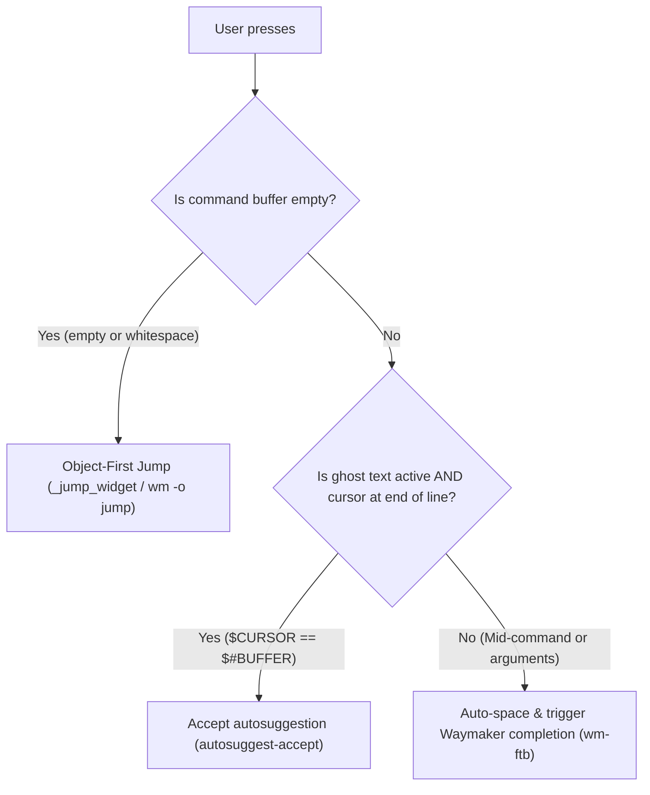
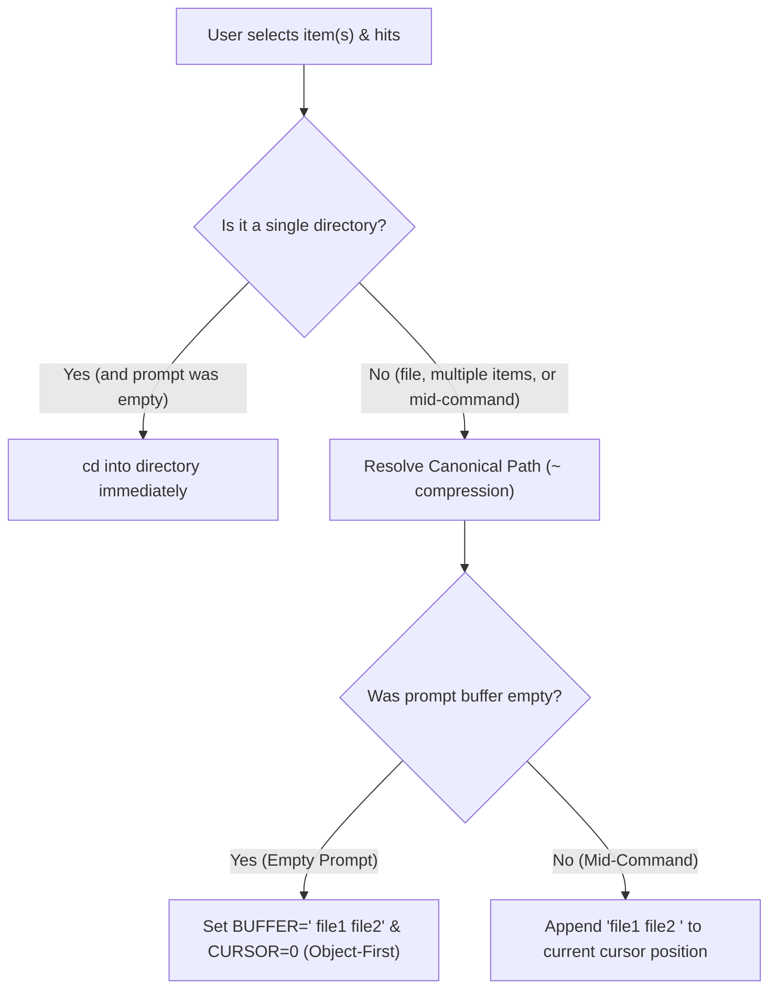

# Smart Tab Completion & Waymaker Integration

The shell tab completion behavior in [`zsh/.zsh/utils/binds.zsh`](../../zsh/.zsh/utils/binds.zsh) provides context-aware logic (`_smart_tab`), automated command spacing, and full integration with the **Waymaker** (`wm` / `mm`) picker engine.

---

## 1. Context-Aware Tab Behaviors (`<Tab>`)

The `_smart_tab` widget detects command-line state and dynamically routes the tab key:



- **Empty Line (`<Tab>`)**: Triggers Waymaker Jump (`_jump_widget`) with **Object-First buffer insertion** (`BUFFER=" $target"`, `CURSOR=0`), or immediate `cd` if a single directory is selected.
- **Autosuggestions at End of Line**: If ghost text is visible and the cursor is at the end of the line (`$CURSOR -eq $#BUFFER`), `<Tab>` accepts the suggestion immediately (`autosuggest-accept`).
- **Middle-of-Line / Arguments (`<Tab>` with text)**: When editing in the middle of a command, `<Tab>` bypasses ghost text and opens Waymaker-powered tab completion (`wm-ftb`) for the specific argument at the cursor.
- **Direct Hotkey (`Ctrl+F`)**: Opens the Waymaker Jump directory interface (`wm -o jump`) at any prompt state.

### 1.1. Deep-Dive: Why `$CURSOR -eq $#BUFFER` Revolutionizes Mid-Line Editing

The `$CURSOR -eq $#BUFFER` check in `_smart_tab` solves one of the most common UX pitfalls in terminals that combine `zsh-autosuggestions` with an interactive completion menu (`fzf-tab` / `wm-ftb`): **line hijacking by ghost text during mid-buffer editing**.

Below are **5 real-world development examples** contrasting the legacy behavior against the current implementation:

---

#### 📌 Example 1: Adding or Completing a Flag in the Middle of a `git commit`

You are composing a commit command and move the cursor back into the middle of the line to add `--amend`:

```text
Typed buffer:
$ git commit --am█ -m "fix(auth): correct token refresh" ░--no-verify░ (gray history suggestion)
                ▲
         $CURSOR is here (middle of the line)
```

* **❌ Legacy behavior (`[[ -n "$POSTDISPLAY" ]]`):**  
  Pressing `<Tab>` on `--am█` detected trailing gray ghost text, **accepted the ghost text**, appended `--no-verify`, jumped the cursor to the end of the line, and **failed to complete** `--amend`.
* **✅ Current behavior (`$CURSOR -eq $#BUFFER`):**  
  Because `$CURSOR < $#BUFFER`, the widget ignores ghost text and opens Waymaker (`wm-ftb`) to complete `--amend` right at the cursor position without mutating the rest of the line.

---

#### 📌 Example 2: Completing Source Paths in Copy/Move Commands (`cp` / `mv` / `rsync`)

You are copying a specific file to a backup folder:

```text
Typed buffer:
$ cp src/comp█/Modal.tsx /tmp/backup/ ░src/components/Button/ /tmp/backup-old/░
            ▲
     $CURSOR is here
```

* **❌ Legacy behavior:**  
  Pressing `<Tab>` to complete `src/components/` accepted the stale history tail, mixing both paths and corrupting the command:  
  `$ cp src/comp/Modal.tsx /tmp/backup/ src/components/Button/ /tmp/backup-old/`
* **✅ Current behavior:**  
  `<Tab>` surgically expands `src/comp` $\rightarrow$ `src/components/` without touching the `/tmp/backup/` destination or pulling stale history arguments.

---

#### 📌 Example 3: Changing Volumes, Ports, or Images in the Middle of `docker run`

You recalled a container command from history and moved back to change the mounted volume:

```text
Typed buffer:
$ docker run -it -v $(pwd)/di█:/app -p 3000:3000 node:20 ░--rm nginx:alpine░
                           ▲
                    $CURSOR is here
```

* **❌ Legacy behavior:**  
  Pressing `<Tab>` to complete `dist/` accepted the old history tail (`--rm nginx:alpine`) and left `di` uncompleted.
* **✅ Current behavior:**  
  `<Tab>` lists and completes local directories matching `$(pwd)/dist/` via `wm-ftb`, leaving subsequent flags intact.

---

#### 📌 Example 4: Editing Filenames Before Extra Editor Flags (`nvim` / `bat` / `cat`)

You are opening a configuration file while passing trailing flags:

```text
Typed buffer:
$ nvim waymaker/.config/waymaker/presets/jum█.toml --clean ░presets/backgrounds.toml░
                                            ▲
                                     $CURSOR is here
```

* **❌ Legacy behavior:**  
  `<Tab>` ignored `jum` and accepted `presets/backgrounds.toml`, overwriting the path you intended to open.
* **✅ Current behavior:**  
  `<Tab>` completes `jump.toml` accurately while preserving `--clean`.

---

#### 📌 Example 5: Completing Workspace Packages in Monorepos and CLIs (`cargo`, `bun`, `pnpm`, `awt`)

When running tests for specific packages in a monorepo:

```text
Typed buffer:
$ cargo test --package waym█ --test integration ░--package waymaker-lib -- --nocapture░
                           ▲
                    $CURSOR is here
```

* **❌ Legacy behavior:**  
  `<Tab>` appended `-- --nocapture` to the end of the line, forcing manual deletion.
* **✅ Current behavior:**  
  `<Tab>` opens the selector with workspace packages (`waymaker-cli`, `waymaker-lib`, etc.) for instant selection with live preview.

---

#### 📊 `_smart_tab` Decision Matrix Summary:

| Cursor Position | Developer Intent | Executed Action |
| :--- | :--- | :--- |
| **Empty Line (`$#BUFFER == 0`)** | Fast navigation (Object-First) | Launches **Waymaker Jump (`_jump_widget`)** with prepended buffer (`BUFFER=" $target"`, `CURSOR=0`) or immediate `cd` if a single directory is chosen. |
| **End of Line (`$CURSOR == $#BUFFER`)** | Accept history suggestion | Executes **`autosuggest-accept`** immediately. |
| **Mid-Command (`$CURSOR < $#BUFFER`)** | Complete argument/path under cursor | Opens **`fzf-tab` with Waymaker (`wm-ftb`)** without polluting the rest of the line. |


---

## 2. Auto-Spacing on Aliases & Commands (`_auto_space_if_command`)

Eliminates the friction of having to manually type a trailing space before requesting argument or branch completion:

- **How it Works**: When you trigger completion directly on an exact alias (`gco`, `ga`, `gst`, `gp`), an executable binary (`cat`, `nvim`, `git`, `kill`), or a shell function without a trailing space, the widget automatically appends a space (`BUFFER="$BUFFER "`) and positions the cursor before delegating to Zsh completion.
- **Examples**:
  - `gco<Tab>` or `gco<Ctrl+N>` $\rightarrow$ immediately opens the Git branch picker without requiring `gco <Tab>`.
  - `cat<Ctrl+N>` $\rightarrow$ immediately lists files in the current directory.
  - `kill<Ctrl+N>` $\rightarrow$ immediately lists process PIDs.
  - Typing a partial word (e.g. `gi` or `ca`) completes the command name itself normally.

---

## 3. Waymaker Completion Backend (`Ctrl+N` / `<Tab>`)

| Keybinding | Backend | Engine | Architecture & Purpose |
| :--- | :--- | :--- | :--- |
| **`Ctrl+N`** / **`<Tab>`** | **Waymaker** | [`wm-ftb`](../../waymaker/.local/bin/wm-ftb) | **Zero-Fork & Zero-Disk I/O**: Direct in-memory streaming with preset [`ftb.toml`](../../waymaker/.config/waymaker/presets/ftb.toml) (<2ms latency) |

---

## 4. Waymaker FZF-Tab Preset Highlights ([`ftb.toml`](../../waymaker/.config/waymaker/presets/ftb.toml))

The dedicated completion preset includes key UX optimizations:

- **Smart Sorting (`matcher.sort = "smart"`)**: Preserves natural stream insertion order (such as most recently committed Git branches) on an empty query, and switches to Nucleo fuzzy relevance scoring as you type.
- **Full-Width Candidate Columns**: Auxiliary prefix and suffix columns are set to `hidden = true`, giving the candidate column 100% of the horizontal window width so Git branch names, commit hashes, and commit messages display completely without truncation.
- **ANSI Color Parsing (`start.ansi = true`)**: Parses ANSI escape sequences emitted by Zsh completion functions and renders true colors.
- **On-Demand Preview (`Ctrl+P`)**: Pressing `Ctrl+P` (`SwitchPreview`) toggles a dynamic preview pane on the right:
  - **🌿 Git Branches & Commits**: Interactive `git log --graph --oneline` commit history.
  - **📄 Files**: Syntax-highlighted content via `bat`.
  - **📁 Directories**: Tree structure via `eza --tree`.
  - **⚙️ Processes (PIDs)**: Process status via `ps -fp`.
- **Footer Hints (`[footer]`)**: Displays subtle keyboard navigation hints at the bottom of the picker interface.

---

## 5. Waymaker Jump Mode ([`jump.toml`](../../waymaker/.config/waymaker/presets/jump.toml))

Triggered directly with `Ctrl+F` (or `<Tab>` on an empty prompt). Optimized for directory traversal, frecency ranking, and file management:

- **Seamless Traversal (`Ctrl+L` / `Ctrl+H` / `l` / `h`)**:
  - **`Ctrl+L` / `l`**: Enters the highlighted directory immediately (`ChDir({=})`), clears the filter input (`Cancel`), and reloads the file list (`Reload`).
  - **`Ctrl+H` / `h`**: Steps up to the parent directory (`ChDir(..)`), clears the filter query, and reloads.
- **Ancestor Jump (`Ctrl+U`)**:
  - Instantly generates and streams the entire upward directory hierarchy (from the current directory up to `/`).
  - Selecting any ancestor directory and pressing `Enter` or `Ctrl+L` jumps straight to that level in 1 step.
  
  > [!TIP]
  > #### 🌟 Where Ancestor Jump Shines:
  > - **Monorepos & Deep Trees**: When you are 5 or 6 levels deep (e.g., `~/dev/github/waymaker/waymaker-lib/src/render/widgets/`) and want to jump back to the repository root (`~/dev/github/waymaker/`) in a single step without pressing `h` or `cd ..` repeatedly.
  > - **Switching Sibling Projects**: Quickly climb to a common parent directory (e.g., `~/dev/github/` or `~/dev/`) to enter another project without leaving Waymaker.
  > - **Preview Auditing**: While scrolling through ancestor directories with `j/k`, the right preview panel displays the tree of each parent directory so you can inspect context before confirming the jump.
  > - **Zero `Alt` Modifiers**: `Ctrl+U` provides an immediate ergonomic mnemonic for **"Upward / Upper Hierarchy"**.
- **Cycle Data Sources (`Tab` / `Shift+Tab`)**: Cycles between Local files (`[start]`), Global Frecency (`wm list`), and Bookmarks (`@bookmarks`).
- **Toggle Preview (`Ctrl+P` / `P`)**: Switches between the 60% split preview and 95% expanded preview.

---

## 6. Keyboard Shortcuts Reference

### Autocomplete Mode (`ftb.toml` / `Ctrl+N` / `<Tab>`)

| Shortcut | Mode | Action | Description |
| :--- | :--- | :--- | :--- |
| **`Ctrl+P`** | All | `SwitchPreview` | **Toggle preview pane on / off** |
| **`Tab`** / **`Ctrl+J`** | All | `Down` | Move selection down |
| **`Shift+Tab`** / **`Ctrl+K`** | All | `Up` | Move selection up |
| **`Enter`** | All | `Accept` | Confirm selection and insert into prompt |
| **`Esc`** / **`Ctrl+C`** | All | `Abort` | Cancel completion |

### Jump Mode (`jump.toml` / `Ctrl+F`)

| Shortcut | Mode | Action | Description |
| :--- | :--- | :--- | :--- |
| **`Ctrl+L`** / **`l`** | Input & Results | `ChDir + Cancel + Reload` | **Enter selected directory seamlessly** |
| **`Ctrl+H`** / **`h`** | Input & Results | `ChDir(..) + Cancel + Reload` | **Go to parent directory seamlessly** |
| **`Ctrl+U`** | Input & Results | `Reload(ancestor hierarchy)` | **Open ancestor directory picker** |
| **`u`** | Results (Nav) | `@undo` | **Undo last File Manager operation (UndoStack)** |
| **`Ctrl+P`** / **`P`** | Input & Results | `SwitchPreview` | **Toggle 60% / 95% directory/file preview pane** |
| **`Tab`** / **`Shift+Tab`** | Input & Results | `ReloadNext` / `ReloadPrev` | **Cycle between Local files, Frecency & Bookmarks** |
| **`f`** / **`/`** / **`i`** | Results (Nav) | `FocusFilter` | **Focus filter input** |
| **`Ctrl+E`** / **`e`** | Input & Results | `Execute(nvim {+})` | **Open selected item(s) in Neovim with frecency boost** |
| **`Space`** | Results (Nav) | `Toggle + Down` | **Multi-select multiple files or directories** |
| **`j` / `k`** | Results (Nav) | `Down / Up` | Vim-style list navigation |
| **`Enter`** | All | `Accept` | Change shell working directory or insert selection |

---

## 7. Zero-Friction & Object-First Buffer Ergonomics

When you exit Waymaker (`_jump_widget`), the widget handles output using **Context-Aware Buffer Placement** and **Canonical Path Resolution**:



### 1. Object-First Command Composition (`CURSOR=0` on Empty Buffer)
When starting from an empty prompt (e.g. hitting `Ctrl+F`), the mental model is **"Object First, Verb Second"**:
1. You open Waymaker and pick `completion.md` (or multiple files).
2. The widget places the cursor at index `0` with a leading space:
   ```zsh
   ❯ █ ~/.dotfiles/main/docs/shell/completion.md
   ```
3. You immediately type your desired tool (`nvim`, `cat`, `rm`, `bat`) and hit `Enter`:
   ```zsh
   ❯ nvim ~/.dotfiles/main/docs/shell/completion.md [ENTER]
   ```
4. **Zero Cursor Navigation**: In Zsh, pressing `Enter` executes the full line buffer regardless of cursor position. No `Home`, `Ctrl+A`, or cursor repositioning keystrokes required.

### 2. Context-Aware Mid-Command Appending
If you invoked the widget while already typing a command (e.g. `git add ` or `cp `):
- The widget appends the formatted selection directly at your active cursor with a trailing space:
  ```zsh
  ❯ git add ~/.dotfiles/main/docs/shell/completion.md █
  ```
- Ready for further flags or immediate execution.

### 3. Smart Path Formatting (Local Relative vs. Global Tilde)
- **Files inside current working directory (`$PWD`)**: Formatted as clean, direct relative paths (e.g. `completion.md` or `docs/shell/completion.md`), eliminating unnecessary path noise.
- **Files outside `$PWD`**: Formatted with canonical tilde compression (`~/.dotfiles/...` instead of full absolute `/home/user/...`), preserving screen real-estate while maintaining universal shell portability and preventing side-effect `cd` execution on file selections.
