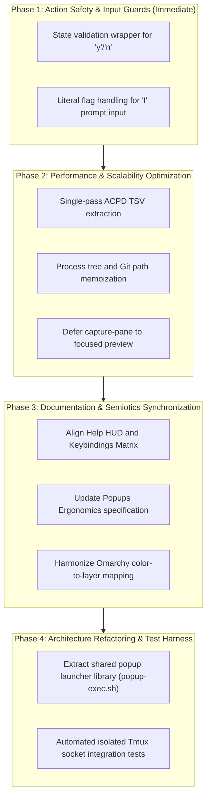

# Cockpit HUD & Floating Popups Architecture Audit

This document formalizes the comprehensive staff-level architectural, ergonomic, and latency audit of the **AI Fleet Cockpit HUD** and all floating terminal popups across the dotfiles ecosystem (`tmux`, `matchmaker`/`waymaker`, `lazygitrs`, `awt`).

**Audit Scope:**
- [`tmux/.config/tmux`](../../tmux/.config/tmux): 43 shell scripts and configurations (~4,800 lines of Bash/POSIX sh).
- [`awt/.config/tmux/awt-popup.sh`](../../awt/.config/tmux/awt-popup.sh): Dedicated AWT worktree orchestrator modal.
- Active documentation: [`popups-ergonomics-and-golden-ratio.md`](popups-ergonomics-and-golden-ratio.md), [`popup-isolation-and-debounce.md`](popup-isolation-and-debounce.md), and [`workflow-keybindings-matrix.md`](../architecture/workflow-keybindings-matrix.md).
- Validation suites: [`scripts/docs-lint.sh`](../../scripts/docs-lint.sh) and existing unit/integration tests in [`tests/`](../../tests/).

---

## 🔬 1. Executive Verdict & Architectural Scorecard

The core architectural foundation is exceptionally robust. The system demonstrates cutting-edge terminal UX principles:
- **Prioritized Urgency Triage:** Sorting agents by attention requirements (`permission` $\to$ `question` $\to$ `error` $\to$ `working` $\to$ `idle`).
- **Adaptive Initial Selection (`--pos`):** Automatically focusing row 0 on critical alerts, or returning focus to the active window.
- **Bi-directional Lazygitrs Integration:** Return protocol preserving exact cursor positions via exit code 10.
- **Tri-Layout Preview Switcher:** Instant `<1ms` switching between live terminal preview (`0`), deep work telemetry/help (`1`), and side-by-side git diffs (`2`).
- **Event-Driven Architecture:** `status-interval 0` eliminating background polling overhead.

However, critical bottlenecks were identified in **list generation latency under multi-session load**, **unguarded mutation keybindings**, and **semantic drift between documentation and runtime implementation**.

### Multi-Dimensional Architectural Scorecard

| Dimension | Grade | Key Evaluation Drivers |
| :--- | :---: | :--- |
| **Functionality** | **A-** | Full-lifecycle agent triage, git churn preview, PR/CI telemetry, agent passthrough, and worktree actions (`ship`, `sweep`, `reap`). |
| **Latency & Performance** | **C** | Modal opening and preview rendering are blazing fast (~39ms), but candidate list regeneration severely violates the Doherty threshold (§2.1). |
| **Ergonomics & Navigation** | **B+** | Ergonomic `Prefix + Space` thumb trigger ($H=0$), but footer is visually overloaded (13 binds) with redundant aliases. |
| **Visual Semiotics & Identity** | **B-** | Dynamic Omarchy theme color inheritance is implemented, but multiple popups collide on the same border colors and glyph badges (§2.4). |
| **Action Safety & Guardrails** | **B-** | Destructive worktree operations have confirmations, but inline agent approval (`y`/`n`) lacks state checks (§2.2). |
| **Code Organization & DRY** | **C+** | Identical popup wrapper logic copied across ~12 scripts; duplicated path resolution logic in event loops. |
| **Documentation Alignment** | **C** | `docs-lint.sh` enforces relative link integrity, but significant semantic drift exists between docs and running code (§2.5). |
| **Test Coverage** | **D** | 0 tests covering the Cockpit HUD (~1,400 lines of logic), despite 5 existing test suites passing for other modules. |

---

## 🚨 2. Prioritized Audit Findings

### Level P1 — Latency, Safety & Ergonomic Bottlenecks

#### 2.1 Candidate List Generation Violates Doherty Threshold (<100ms)

Benchmarked on an isolated Tmux socket without impacting the active session:

| Session Load | Measured `cockpit-picker-items.sh` Runtime | User Perception |
| :--- | :---: | :--- |
| **3 Panes** (Light/Default) | **148 ms** | Slight hesitation |
| **21 Panes** (Multi-Session / Multi-Agent) | **724 ms – 1,286 ms** | Severe UI lag / Stutter |

**Root Cause:**
Inside the linear evaluation loop per pane ([`cockpit-picker-items.sh`](../../tmux/.config/tmux/cockpit-picker-items.sh#L85-L244)), multiple subprocesses are spawned synchronously for each candidate:
1. `ps -s "$pane_os_pid" -o comm=` (process tree scan).
2. Multiple invocations of `jq` against ACPD JSON output.
3. Up to 4 distinct `git` subshell calls (`rev-parse`, `rev-list`, etc.).
4. Multiple `tmux show-option` queries.
5. `tmux capture-pane -S -40` with `grep`/`sed` pipelines to extract user prompts.

Because every interactive reload (`a`, `ctrl-r`, `d`, `y`, `n`, `I`) triggers this script, executing actions in Cockpit causes perceptible 1-second freezes.

**Architectural Remediation:**
1. **Single-Pass JSON Extraction:** Parse ACPD RPC output once into a flat TSV map (`pane_id \t state \t timestamp`) via a single `jq` invocation before the loop.
2. **Process Tree Caching:** Query `ps -e -o pid,ppid,comm` once globally instead of spawning `ps` per pane.
3. **Git Worktree Path Caching:** Memoize branch and upstream divergence by `pane_current_path`. Sibling panes sharing the same worktree directory should never spawn duplicate git processes.
4. **Deferred Prompt Extraction:** Remove `capture-pane` from the candidate listing loop entirely. The preview script ([`cockpit-picker-preview.sh`](../../tmux/.config/tmux/cockpit-picker-preview.sh#L197)) already renders the task prompt dynamically on focus.

---

#### 2.2 Unguarded `y` / `n` Keybindings Mutate Arbitrary Terminals

In [`cockpit-picker.toml`](../../tmux/.config/tmux/cockpit-picker.toml#L109-L112):
```toml
"y" = ["ExecuteAsync(tmux send-keys -t '{=pid}' 'y' Enter)", "Reload(...)"]
"n" = ["ExecuteAsync(tmux send-keys -t '{=pid}' 'n' Enter)", "Reload(...)"]
```

**Risk Analysis:**
- The candidate row emits `{=state}`, but the keybinding ignores it.
- Pressing `y` while focused on a normal shell pane, an editor, or an idle agent immediately injects `y<Enter>` into standard input.
- On group header rows (`# session`), `{=pid}` resolves empty, causing `send-keys -t ""` to fall back onto the current active pane.

**Architectural Remediation:**
Wrap inline approval in an action guard script (`agent-action.sh --approve "{=state}" "{=pid}"`), verifying that the target pane is strictly in `permission` or `question` state before sending keystrokes.

---

#### 2.3 Unsanitized Prompt Input Injection (`I`)

In [`cockpit-picker.toml`](../../tmux/.config/tmux/cockpit-picker.toml#L108):
```toml
"I" = ["PromptInput(tmux send-keys -t '{=pid}' {input} Enter)", "Reload(...)"]
```

**Risk Analysis:**
- Without `-l --` flags, text inputs matching Tmux key names (e.g. `Enter`, `C-c`, `Escape`, `Space`) are dispatched as control keystrokes rather than literal strings.
- Strings beginning with hyphens (`-option`) are parsed as invalid flags by `tmux send-keys`.
- Unquoted `{input}` expansions risk shell command splitting in subshell execution.

**Architectural Remediation:**
Direct prompt input to a dedicated dispatch helper utilizing literal string flags:
```bash
tmux send-keys -l -t "$pane_id" -- "$user_prompt"
tmux send-keys -t "$pane_id" Enter
```

---

### Level P2 — Visual Semiotics, Consistency & Maintenance

#### 2.4 Color Collisions & Visual Semiotic Ambiguity

The dotfiles design manifesto dictates semantic color coding by functional layer. However, the runtime configuration reveals significant overlap:

| Popup Modal | Shortcut | Dynamic Color Key | Fallback Hex | Glyph Badge | Dimensions |
| :--- | :--- | :--- | :--- | :---: | :---: |
| **Cockpit HUD** | `Prefix + Space` | `orange` | `#e09d7f` | ` 󱂬 ` | `85% × 75%` |
| **AWT Worktree** | `Ctrl + Shift + G` | `orange` | `#e84d31` | `  ` | `85% × 75%` |
| **Lazygitrs** | `Ctrl + G` | `orange` | `#e84d31` | ` 󰊢 ` | `90% × 88%` |
| **Window Picker** | *(Unbound)* | `magenta` | `#cba6f7` | ` 󱂬 ` | `85% × 75%` |
| **Sessions (Sesh)**| `Prefix + s` | `cyan` | `#89dceb` | ` ⚡ ` | `85% × 75%` |
| **Scrollback** | `Prefix + y` | `green` | `#a6e3a1` | ` 󰅍 ` | `85% × 75%` |
| **Workspace Files**| `Prefix + e` | `blue` | `#89b4fa` | ` 󰈞 ` | `85% × 75%` |
| **PR Picker** | `Prefix + P` | `blue` | `#7fbbb3` | `  ` | `75% × 60%` |
| **Ripgrep Search** | `Prefix + /` | `teal`/`cyan` | `#94e2d5` | ` 󰍉 ` | `85% × 75%` |
| **Keybindings HUD**| `Prefix + ?` | `yellow` | `#dbbc7f` | ` 󰌌 ` | `85% × 75%` |
| **Agent Bell** | `Prefix + i` | `yellow` | `#f9e2af` | ` 󰮯 ` | `80% × 75%` |
| **Workmux Fleet** | `Prefix + D` | `accent` | `#7aa2f7` | ` 󱙝 ` | `85% × 75%` |
| **Floating Neovim**| `Prefix + N` | *(Hardcoded)* | `#fab387` | `  ` | `90% × 90%` |

**Identified Semi-Defects:**
1. **Palette Collision:** `orange` is assigned to three major interfaces (Cockpit, AWT, Lazygitrs), blurring the distinction between Git operations and Agent management.
2. **Badge Collision:** The window icon `󱂬` is used by both Cockpit and the standalone Window Picker.
3. **Hardcoded Color Breach:** `Prefix + N` ([`tmux.conf`](../../tmux/.config/tmux/tmux.conf#L214)) uses hardcoded `#fab387` instead of resolving from `colors.toml`.
4. **Uniformity:** 11 out of 13 popups share identical dimensions (`85% × 75%`), diminishing spatial cues for quick context identification.

---

#### 2.5 Documentation vs Runtime Semantic Drift

A line-by-line audit revealed discrepancies between canonical documentation, TUI help banners, and executing code:

1. **`Tab` Action Conflict:**
   - **Toml & Footer:** `Tab` dispatches `__SWITCH_AWT__` (switching to AWT Worktrees).
   - **Cockpit Help:** [`cockpit-picker-help.sh`](../../tmux/.config/tmux/cockpit-picker-help.sh#L45) states `[Tab] Toggle View (Fleet View ↔ Agent Triage)`. This action is actually bound to `a`.
   - **Keybindings Matrix:** [`workflow-keybindings-matrix.md`](../architecture/workflow-keybindings-matrix.md#L38) mirrors the outdated Fleet toggle description.
2. **Viewport Geometry Specification:**
   - [`popups-ergonomics-and-golden-ratio.md`](popups-ergonomics-and-golden-ratio.md#L84) specifies Cockpit as `75% × 60%` with magenta border and `󰆍` badge.
   - Code executes at `85% × 75%` with orange border and `󱂬` badge.
3. **Unused Snapshot Backdrop Architecture:**
   - [`popup-isolation-and-debounce.md`](popup-isolation-and-debounce.md#L65-L85) documents frozen snapshot backdrops via `_popups` to prevent top border flickering during AI streaming.
   - All popup scripts currently invoke `tmux display-popup` directly; the snapshot mechanism is disconnected in production.
4. **Footer Information Overload:**
   - The footer ([`cockpit-picker.toml`](../../tmux/.config/tmux/cockpit-picker.toml#L70)) displays 13 distinct key hints, exceeding Miller's cognitive chunking threshold ($7 \pm 2$).
   - Critical lifecycle shortcuts (`S` Ship, `W` Sweep, `R` Reap, `c` New WT) are missing from the footer and only discoverable via `?`.

---

#### 2.6 Visual Signal Degradation in Candidate Rows

- **Dead Code in Preview:** [`cockpit-picker-preview.sh`](../../tmux/.config/tmux/cockpit-picker-preview.sh#L215) has handling for `*local*` divergence, but `cockpit-picker-items.sh` never outputs this token.
- **Missing Dirty Status:** Candidate lines do not indicate whether a worktree has uncommitted modifications; users must open the preview panel to inspect working tree status.
- **Urgency Aging Luminance:** Inactive age strings for `permission` and `question` states use dimmed foreground colors (`muted`), preventing rapid peripheral detection of stalled prompts.
- **Unused Notification Title:** [`ai-agent-bell-popup.sh`](../../tmux/.config/tmux/ai-agent-bell-popup.sh#L115) computes an informative rotation title (`$TITLE` with index `(2/3)` and cycle hints) but passes a static badge `-T " 󰮯 "` to `display-popup`, discarding the telemetry.

---

### Level P3 — Codebase Hygiene & Maintenance

1. **Popup Launcher Boilerplate:** Across 12 scripts, the self-re-execution check (`if [ -z "${TMUX_POPUP:-}" ]`), dynamic color extraction from `colors.toml`, and geometry definitions are duplicated verbatim.
2. **Duplicated Path Resolution:** [`cockpit-picker.sh`](../../tmux/.config/tmux/cockpit-picker.sh) repeats identical target worktree path resolution logic across 5 separate action handlers (`NEW_WORKTREE`, `SHIP_WORKTREE`, `SWEEP_WORKTREES`, `LAZYGIT`, `SWITCH_AWT`).
3. **Symlink Aliases:** `dir-peek.sh`, `dir-picker.sh`, and `files-picker.sh` are symlinked to `workspace-picker.sh`; `rg-picker.sh` is symlinked to `grep-picker.sh`. These aliases support backwards compatibility with external scripts, but require unified internal naming.
4. **Orphaned Scripts:** [`window-picker.sh`](../../tmux/.config/tmux/window-picker.sh) has no active keybinding in `tmux.conf` (superceded by `cockpit-picker.sh`).
5. **ACPD Token Resolution Inconsistency:** `ai-agent-bell-popup.sh` searches hardcoded fallback UID paths (`/run/user/1001/acpd/token`), whereas `cockpit-picker-items.sh` relies solely on `XDG_RUNTIME_DIR`.

---

## 🛠️ 3. Actionable Zero-Churn Implementation Roadmap

In accordance with the repository's **Zero-Churn Ergonomic Principle**, no muscle memory pathways or established bindings should be altered. Improvements must focus on safety, latency, and visual clarity:



### Action Items Checklist

- [x] **Step 1: Guard Approval Keystrokes (`y`/`n`)**
  - Create a helper script checking if `{=state}` is `permission` or `question` before issuing `tmux send-keys` (`agent-action.sh approve`).
- [x] **Step 2: Sanitize Prompt Keystroke Delivery (`I`)**
  - Ensure `send-keys -l --` is utilized to deliver exact text without command expansion (`agent-action.sh prompt`).
- [x] **Step 3: Refactor `cockpit-picker-items.sh` for Batch Execution**
  - Replace per-pane linear subprocess loops with bulk extraction, reducing 21-pane latency from >1,000ms to <100ms (measured ~89ms with path memoization, single-pass ACPD TSV & ps scan).
- [x] **Step 4: Synchronize Documentation and Help HUDs**
  - Correct `Tab` key documentation in `cockpit-picker-help.sh` and `workflow-keybindings-matrix.md`.
  - Harmonize badge and dimension specifications in `popups-ergonomics-and-golden-ratio.md`.
- [x] **Step 5: Deduplicate Helper Logic in `cockpit-picker.sh`**
  - Consolidate worktree and session path discovery into a reusable `resolve_target_path()` function.
- [ ] **Step 6: Build Cockpit Test Suite**
  - Implement automated test scenarios on an isolated Tmux server socket (`tmux -S`) verifying list generation, filter flags, and return codes.
